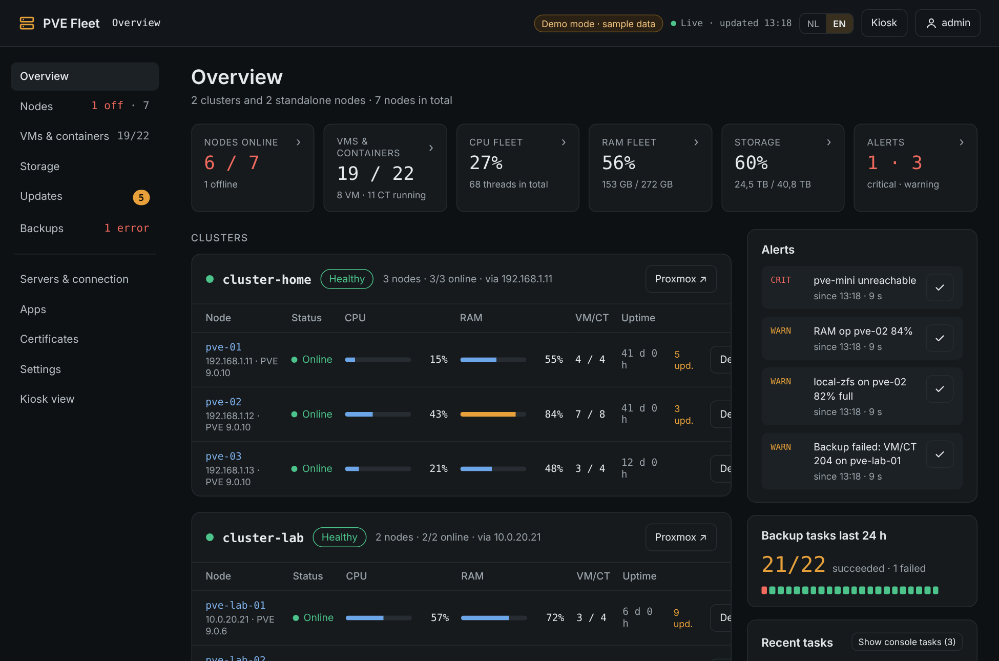
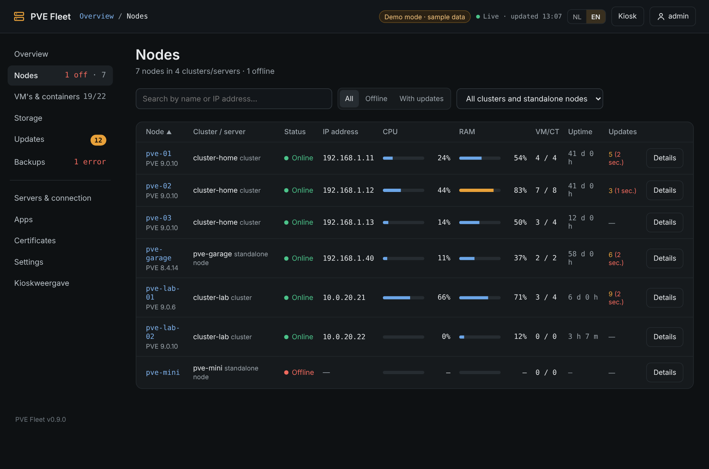
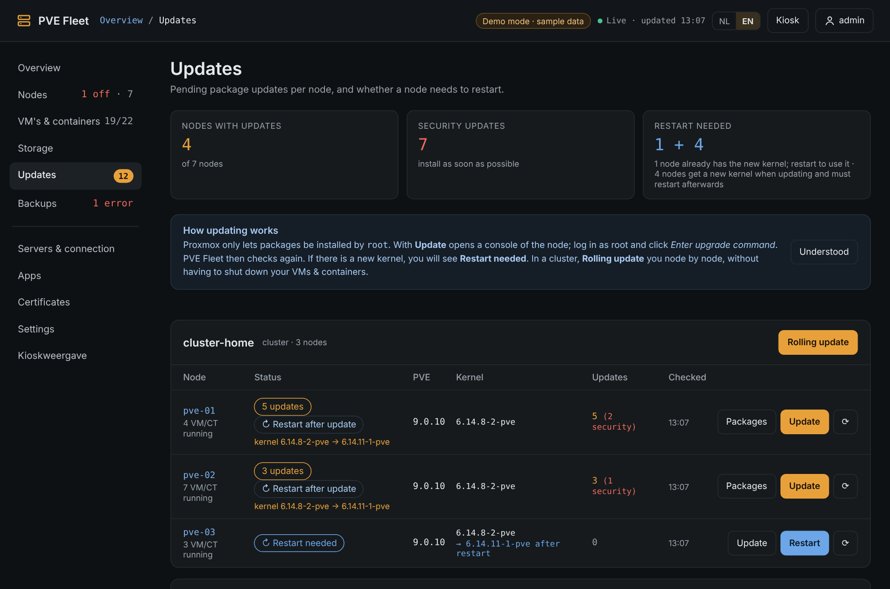
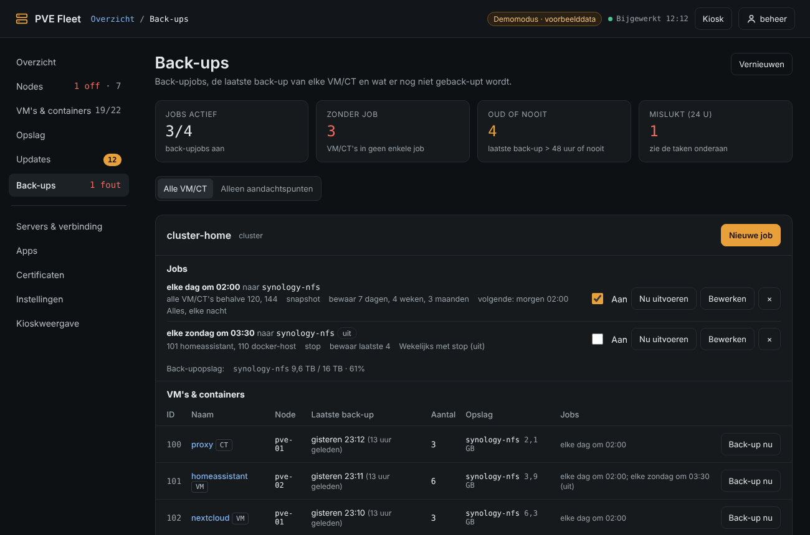
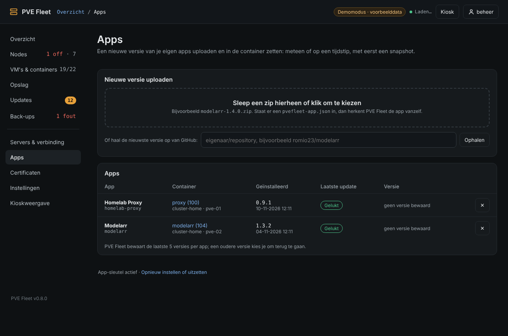

# PVE Fleet

🇬🇧 [English documentation](README.md)

Een dashboard voor al je Proxmox VE-servers in één scherm: clusters én losse nodes. Je ziet de health van nodes, VM's en containers, met een aparte kioskweergave voor een iPad of een klein scherm aan een Raspberry Pi.

**Versie 0.9.4.** Nieuw: back-ups naar netwerkopslag. Bij *Recente back-uptaken* staat waarom een back-up mislukte (uit de log van Proxmox). Kunnen unprivileged containers hun tijdelijke map niet op een NFS/SMB-share zetten (`.tmp: Cannot open: Permission denied`), dan legt PVE Fleet dat uit en geeft het commando dat `tmpdir: /var/tmp` op alle nodes instelt. Bij het maken van een back-upjob waarschuwt PVE Fleet vooraf als een job op netwerkopslag unprivileged containers bevat. Versie 0.9.3: nieuw: de tegel *Updates* in de kiosk telt naast nodes ook de containers mee (bijvoorbeeld *5 nodes · 7 containers · 16 security*). Back-upjobs: knopjes en uitleg bij de variabelen voor de notitie (`{{guestname}}`, `{{vmid}}`, `{{node}}`, `{{cluster}}`) met een voorbeeld dat meeverandert. Ontbreekt er een recht (bijvoorbeeld `Datastore.Allocate` op een back-upopslag), dan noemt de melding dat recht en staan de `pveum`-commando's klaar om te kopiëren. Versie 0.9.2: nieuw: op de pagina *Updates* kies je hoe vaak de containers gecontroleerd worden: om de zoveel uur, of elke dag op een vast tijdstip (*Wijzigen* naast "gecontroleerd"). VM's en containers op een node die offline is, houden hun naam, IP-adres en geheugen (laatst bekende gegevens uit `data/guest_cache.json`, met *laatst gezien*); de status heet nu *Node offline* in plaats van *Onbekend*. Het Docker-image bevat nu tijdzonegegevens, zodat `TZ=Europe/Amsterdam` binnen de container echt gebruikt wordt. Versie 0.9.1: reparatie: de lijst met community-scripts-apps (`app/data/community_apps.json`) ontbrak op GitHub, waardoor app-updates in containers niet werden herkend na een update via GitHub. **Versie 0.9.0.** Nieuw: de hele interface en documentatie in het Nederlands en Engels (schakelaar NL | EN; standaard volgt hij de taal van je browser). Versie 0.8.0: de nieuwste versie van een app **ophalen van GitHub** (Apps) en `update.sh` om PVE Fleet zelf bij te werken. Eerder (0.7.0): **Apps**, een nieuwe versie van je eigen apps uploaden en in de LXC-container zetten, meteen of op een tijdstip, met eerst een snapshot (hoofdstuk 14). Eerder: certificaten voor PVE Fleet (https) en de Proxmox-nodes, via Let's Encrypt of een eigen certificaat (hoofdstuk 13); schermen koppelen met een QR-code; Nederlandse taaknamen en consoletaken standaard verborgen in Recente taken; updates in containers (pakketten en app-versies, hoofdstuk 12). Eerder: root-sessie voor de console, VM's & containers in de kiosk, de pagina's *Updates* (met rolling update) en *Back-ups*, VM/CT- en node-acties, ingebouwde console, IP-adressen en opgemaakte notities.

## Screenshots

Gemaakt in de demomodus (voorbeelddata, geen echte servers); de schermafbeeldingen zijn Engelstalig.

| | |
|---|---|
|  **Overzicht:** clusters, nodes, alerts en back-ups in één scherm |  **Nodes:** alle nodes van alle servers, zoeken en sorteren |
|  **Updates:** openstaande updates per node en rolling update |  **Back-ups:** laatste taken en mislukte back-ups |
|  **Apps:** een nieuwe versie uploaden of van GitHub ophalen en in een container zetten | |

## Wat zit erin

| Pagina | Adres | Wat je ziet |
|---|---|---|
| Overzicht | `/` | Kerncijfers (klikbaar), clusters met quorum, losse nodes, alerts, back-uptaken, recente taken |
| Nodes | `/nodes` | Alle nodes van alle clusters en losse servers; zoeken, filteren (offline, met updates) en sorteren op CPU, RAM, uptime |
| VM's & containers | `/vms` | Alle VM's en containers over al je servers; zoeken op naam/ID/tag/node, filters (actief/gestopt, VM/CT, per cluster of node), sorteren en bulkacties |
| Opslag | `/storage` | Alle opslag, de volste bovenaan; gedeelde opslag één keer per cluster |
| Node | `/node/<server>/<node>` | CPU/RAM/netwerk/IO van het laatste uur, VM's en containers, opslag, SMART, openstaande updates, taken |
| VM/CT | `/guest/<server>/<node>/<qemu\|lxc>/<id>` | Grafieken, configuratie, IP-adres, snapshots, back-ups, knop voor de ingebouwde console |
| Kiosk | `/kiosk` | Wisselen tussen **Nodes** en **VM's & containers** (filter actief/gestopt, tik voor details); grote tegels per node, alerts met "gezien"-knop, klok; node herstarten/afsluiten/wekken met pincode; geschikt voor touchscreen |
| Updates | `/updates` | Per node openstaande updates (security apart), kernel en of een herstart nodig is; pakketlijst, bijwerken via de console, rolling update per cluster |
| Back-ups | `/backups` | Back-upjobs (aan/uit, nu uitvoeren, maken, wijzigen, verwijderen), laatste back-up per VM/CT, VM/CT's zonder job, recente back-uptaken |
| Apps | `/apps` | Eigen apps: zip uploaden, versie kiezen, meteen of later bijwerken in de container, met snapshot en automatisch terugzetten; geplande en eerdere updates met log |
| Instellingen | `/settings` | Pincode aan/uit en wijzigen, kiosk-opties, schermen koppelen, wachtwoord, logboek van acties |
| Servers | `/servers` | Verbindingsstatus per server en uitleg over API-tokens |

**Acties per plek**

| Waar | Acties |
|---|---|
| Node-pagina | Node herstarten, afsluiten (naam intypen ter bevestiging), Wake-on-LAN en opnieuw verbinden als hij offline is. VM's & containers selecteren en in één keer starten, afsluiten, herstarten, snapshotten, back-uppen of migreren |
| VM/CT-pagina | Starten, afsluiten, herstarten, geforceerd stoppen, snapshot maken, terugdraaien of verwijderen, back-up nu, migreren (de pagina verhuist mee) |
| Kiosk | Node herstarten, afsluiten, Wake-on-LAN, opnieuw verbinden, meldingen bevestigen |
| Console | Scherm van een VM, terminal van een container, shell van een node; opent in een eigen venster (alleen beheerder) |

Elke actie vraagt eerst om bevestiging. Rechtsonder zie je de voortgang van de Proxmox-taak, met een knop **Log** voor de uitvoer. Alles komt in het logboek onder Instellingen.

Alerts verschijnen voor: een server of node die onbereikbaar of offline is, een cluster zonder quorum, RAM boven 80/90%, CPU boven 90%, opslag boven 80/90% en mislukte back-uptaken in de laatste 24 uur.

---

## 1. Snel proberen (demomodus)

Zonder `data/config.yml` start het dashboard met voorbeelddata. Zo kun je alles eerst bekijken:

```bash
docker compose up -d --build
```

Open daarna `http://<ip-van-de-pi>:8080`.

Zonder Docker kan het ook:

```bash
python3 -m venv .venv && . .venv/bin/activate
pip install -r requirements.txt
python run.py
```

### Eerste keer: account en pincode

Bij de eerste start vraagt het dashboard om een **gebruikersnaam, wachtwoord en kiosk-pincode**. Die worden (als hash) bewaard in `data/settings.json`. Wachtwoord vergeten? Verwijder dat bestand en start opnieuw; je stelt dan alles opnieuw in en koppelt je schermen opnieuw.

## 1b. Testen op Windows

Je kunt het dashboard ook op je Windows-pc draaien, handig om te testen voordat het naar de Pi gaat.

1. Installeer **Python 3.9 of nieuwer** (eenmalig). Typ in PowerShell `winget install Python.Python.3.13`, of download het via python.org en vink *Add python.exe to PATH* aan.
2. Pak de zip uit naar een gewone map, bijvoorbeeld `C:\PVE-Fleet`.
3. Dubbelklik op **`START_WINDOWS.bat`**.
   - De eerste keer maakt hij een eigen Python-omgeving (map `.venv`) en installeert hij de pakketten. Dat duurt een minuutje.
   - Daarna opent je browser vanzelf `http://localhost:8080`.
   - Stoppen: sluit het zwarte venster of druk op Ctrl+C.
4. Eigen servers testen: kopieer `config.example.yml` naar `data\config.yml`, vul je servers en tokens in en start opnieuw.

**`START_DEMO_WINDOWS.bat`** start altijd met voorbeelddata, ook als er al een `data\config.yml` is.

De eerste keer vraagt Windows Firewall of het programma mag communiceren. Kies **Privé netwerken** als je de kiosk ook op je iPad wilt proberen (`http://<ip-van-je-pc>:8080/kiosk`). Wil je hem alleen op de pc zelf gebruiken, start dan in de opdrachtprompt `START_WINDOWS.bat --host 127.0.0.1`.

Andere opties: `--port 9000` (andere poort) en `--no-browser` (browser niet openen).

Heb je Docker Desktop, dan werkt `docker compose up -d --build` uit hoofdstuk 1 ook op Windows.

## 2. Raspberry Pi voorbereiden

Een Pi 4 met 2 GB is genoeg voor het dashboard. Draai je ook het scherm op de Pi zelf (Chromium), neem dan 4 GB of meer.

1. Zet **Raspberry Pi OS (64-bit)** op een SSD of SD-kaart met Raspberry Pi Imager. Kies *Lite* als de iPad het scherm wordt, of de desktopversie als er een scherm aan de Pi komt. Zet in de Imager meteen SSH, je gebruikersnaam en je wifi aan.
2. Geef de Pi een vast IP-adres, bijvoorbeeld met een DHCP-reservering in je router.
3. Installeer Docker:
   ```bash
   curl -fsSL https://get.docker.com | sh
   sudo usermod -aG docker $USER   # daarna opnieuw inloggen
   ```

> Tip: een SSD via USB 3 gaat veel langer mee dan een SD-kaart.

## 3. Installeren

Kopieer deze map naar de Pi (bijv. naar `~/pve-fleet`), dan:

```bash
cd ~/pve-fleet
mkdir -p data
cp config.example.yml data/config.yml
nano data/config.yml          # servers en tokens invullen, zie hieronder
docker compose up -d --build
```

Controleren of alles draait: `docker compose logs -f` en `http://<ip-van-de-pi>:8080/servers`.

Bijwerken naar een nieuwe versie, in de map van PVE Fleet op de Pi:

```bash
sh update.sh            # haalt de nieuwste release (of tag) van GitHub op en bouwt de container opnieuw
sh update.sh --check    # alleen kijken: wat staat erop en wat is de nieuwste versie
sh update.sh v0.8.0     # een bepaalde release, tag of tak (bijvoorbeeld main)
sh update.sh nieuw.zip  # een zip van je eigen schijf
```

Het script maakt eerst een back-up van `data/` (naast de map, de laatste drie blijven bewaard), laat `data/`, `.env` en je `docker-compose.yml` staan (een nieuwe compose-file komt ernaast als `docker-compose.yml.new`) en draait `docker compose up -d --build`. Een andere repository: `REPO=eigenaar/naam sh update.sh`; een privé-repository: `GITHUB_TOKEN=... sh update.sh`. Staat er nog geen `update.sh` in je map (versie 0.7.0 of ouder), dan eenmalig de bestanden van de nieuwe versie over de oude zetten en `docker compose up -d --build` draaien; daarna werkt `update.sh`. Er moet op GitHub een **release of tag** zijn: een gewone commit op `main` telt niet.

## 4. API-token maken in Proxmox

Doe dit **één keer per cluster** en **één keer per losse node**.

Via de webinterface:

1. *Datacenter › Permissions › Users › Add*: gebruiker `dashboard`, realm *Proxmox VE authentication server* (`dashboard@pve`).
2. *Datacenter › Permissions › Add › User Permission*: pad `/`, gebruiker `dashboard@pve`, rol **PVEAuditor**.
3. *Datacenter › Permissions › API Tokens › Add*: gebruiker `dashboard@pve`, token-ID `fleet`, **Privilege Separation uit**. Kopieer het geheim; je ziet het maar één keer.

Of in de shell van een node (aanbevolen, inclusief de rechten voor acties):

```bash
pveum user add dashboard@pve --comment "PVE Fleet"
pveum role add FleetOperator --privs "VM.PowerMgmt VM.Snapshot VM.Snapshot.Rollback VM.Backup VM.Migrate Datastore.AllocateSpace Sys.PowerMgmt VM.Console Sys.Console VM.GuestAgent.Audit"
pveum acl modify / --users dashboard@pve --roles PVEAuditor,FleetOperator
pveum user token add dashboard@pve fleet --privsep 0
```

Heb je in stap 1 al een token gemaakt? Dan zijn alleen de regels `pveum role add` en `pveum acl modify` nodig; het token zelf blijft hetzelfde.

### Rechten voor acties

| Actie | Recht in Proxmox |
|---|---|
| Alles bekijken | `PVEAuditor` (rol) |
| VM/CT starten, afsluiten, herstarten, stoppen | `VM.PowerMgmt` |
| Snapshot maken of verwijderen | `VM.Snapshot` |
| Snapshot terugdraaien | `VM.Snapshot.Rollback` |
| Back-up nu | `VM.Backup` + `Datastore.AllocateSpace` op de back-upopslag |
| Migreren | `VM.Migrate` (+ `Datastore.AllocateSpace` bij lokale schijven) |
| Node herstarten, afsluiten, Wake-on-LAN via het cluster | `Sys.PowerMgmt` |
| Console van een VM of container | `VM.Console` |
| Shell van een node | `Sys.Console` |
| IP-adres van een VM (via de QEMU guest agent) | `VM.GuestAgent.Audit` (Proxmox 9) of `VM.Monitor` (Proxmox 8) |
| Back-upjob nu uitvoeren | `VM.Backup` + `Datastore.AllocateSpace` (zit al in FleetOperator) |
| *Optioneel:* lijst met openstaande updates lezen, back-upjobs maken/wijzigen/verwijderen/aan-uit | `Sys.Modify` op `/` (zie hoofdstuk 11) |

Wil je alleen kijken, geef dan alleen PVEAuditor: elke actie meldt dan netjes welk recht ontbreekt.

**Rechten controleren:** bij *Servers & verbinding › Bewerken › Verbinding testen* leest het dashboard de rechten van het token uit. Per onderdeel zie je ✓ of ✗. Ontbreekt er iets, dan staan er `pveum`-commando's klaar die precies bij jouw token passen, met een kopieerknop.

**Privilege Separation:** maak je het token in de webinterface, dan staat *Privilege Separation* standaard aan. Het token heeft dan zijn eigen rechten nodig, naast die van de gebruiker:

```bash
pveum acl modify / --tokens 'dashboard@pve!fleet' --roles PVEAuditor,FleetOperator
```

De enkele aanhalingstekens zijn nodig vanwege het uitroepteken.

### Wake-on-LAN

- **Clusternode:** het dashboard vraagt een andere node in het cluster om hem te wekken. Proxmox moet daarvoor het MAC-adres kennen: `pvenode config set -wakeonlan AA:BB:CC:DD:EE:FF` (op de node die gewekt moet worden, terwijl hij nog aan staat).
- **Losse node:** het dashboard stuurt zelf het wekpakket. Zet het MAC-adres in `config.yml` met `wol_mac:` (zie het voorbeeld). Op de Pi werkt dat dankzij `network_mode: host` in `docker-compose.yml`; op Windows werkt het direct.
- Zet Wake-on-LAN ook aan in het BIOS/UEFI van de server.

### Server toevoegen in het dashboard (aanbevolen)

Ga naar **Servers & verbinding › + Server toevoegen**, vul de IP-adressen, de token-ID en het token-geheim in en klik op **Verbinding testen**. Het dashboard:
- herkent zelf of het een cluster of een losse node is, en vult de naam in;
- laat per IP-adres zien of het bereikbaar is;
- biedt aan om de IP's van alle clusternodes over te nemen;
- legt uit wat er mis is als het niet lukt.

Met **Toevoegen** of **Opslaan** schrijft het dashboard `data/config.yml` en gebruikt het de nieuwe instellingen meteen; herstarten is niet nodig. De vorige versie blijft bewaard als `config.yml.bak`. Opmerkingen die je zelf in het bestand had gezet, verdwijnen bij opslaan. Staat de demomodus nog aan, dan gaat die bij je eerste server vanzelf uit.

### Of: zelf config.yml bewerken

In `data/config.yml`:

```yaml
servers:
  - name: cluster-home
    hosts: [192.168.1.11, 192.168.1.12, 192.168.1.13]   # failover binnen het cluster
    token_id: "dashboard@pve!fleet"
    token_secret: "het-geheim-uit-stap-3"
    verify_ssl: false
  - name: pve-garage
    host: 192.168.1.40
    token_id: "dashboard@pve!fleet"
    token_secret: "..."
```

Herstart daarna met `docker compose restart`.

Een paar opmerkingen:
- **PVEAuditor** mag alles lezen en niets wijzigen; de rol **FleetOperator** hierboven voegt precies de rechten voor de acties toe.
- Afhankelijk van je Proxmox-versie heeft het lezen van de **lijst met updates** meer rechten nodig (`Sys.Modify`). Zonder dat recht toont het dashboard bij updates "geen rechten"; de rest werkt gewoon.
- Proxmox gebruikt standaard een zelfondertekend certificaat, daarom `verify_ssl: false`. Heb je een geldig certificaat, zet het dan op `true`.
- Zet `data/config.yml` op alleen-lezen voor jezelf: `chmod 600 data/config.yml`.

## 5. Kiosk op een iPad

1. Maak in het dashboard op je pc een koppelcode via **Instellingen › Gekoppelde schermen › Scherm koppelen**. Je ziet een **QR-code** en een cijfercode.
   - **QR-code:** scan hem met de camera van de iPad en tik op de melding. Safari opent de kiosk en het scherm is meteen gekoppeld.
   - **Cijfercode:** open `http://<ip-van-de-pi>:8080/kiosk` in Safari en tik de 6 cijfers in.

   Beide zijn 10 minuten geldig en werken één keer. De iPad blijft daarna gekoppeld; ontkoppelen doe je ook in Instellingen. Open je het dashboard op de Pi zelf via `localhost`, dan zet PVE Fleet het netwerkadres van de Pi in de QR-code.
2. Deel-knop › **Zet op beginscherm**. Het dashboard opent dan schermvullend.
3. Instellingen › Scherm en helderheid › Automatisch vergrendelen: **Nooit**.
4. Instellingen › Toegankelijkheid › **Begeleide toegang** aan. Open de app en klik drie keer op de zijknop of thuisknop om de iPad op dit scherm vast te zetten.

Werkt goed vanaf iPadOS 15 (iPad Air 2 / mini 4 en nieuwer). Laat de iPad liefst niet jarenlang op 100% aan de lader hangen; een slimme stekker die tussen ongeveer 20% en 80% laadt, spaart de accu.

## 6. Kiosk op een scherm aan de Pi

Gebruik hiervoor Raspberry Pi OS **met desktop** en stel via `sudo raspi-config` › *System Options* › *Boot / Auto Login* in dat de Pi automatisch inlogt op de desktop.

Laat Chromium bij het opstarten de kiosk openen. Op recente versies van Raspberry Pi OS (desktop *labwc*):

```bash
mkdir -p ~/.config/labwc
echo 'chromium --kiosk --noerrdialogs --disable-infobars --incognito http://localhost:8080/kiosk &' >> ~/.config/labwc/autostart
```

Een browser op de Pi zelf (`localhost`) hoeft niet gekoppeld te worden, zolang **Kiosk op deze computer zonder koppelen** aan staat (Instellingen). Heet het programma bij jou `chromium-browser`, gebruik dan die naam. Gebruikt je Pi nog een andere desktop (zoals *wayfire*), dan staat het autostart-bestand ergens anders; zoek dan op "autostart" voor jouw versie van Raspberry Pi OS.

## 7. Kiosk-pincode

- Standaard vraagt de kiosk de pincode bij **node herstarten** en **node afsluiten**. Onder *Instellingen › Kiosk & schermen* kies je ook Wake-on-LAN en meldingen bevestigen, en hoe lang de kiosk daarna ontgrendeld blijft (0 s, 30 s, 2 of 5 min).
- Na 5 foute pogingen is de kiosk 1 of 5 minuten geblokkeerd, of tot je de blokkade in Instellingen opheft. Je krijgt dan ook een melding in het dashboard.
- Zet je de pincode uit, dan kan iedereen die het scherm aanraakt de nodes herstarten. Voor een scherm op een openbare plek is **Alleen bekijken** veiliger.
- In het dashboard zelf ben je ingelogd met je wachtwoord; daar is geen pincode nodig.

## 8. Veiligheid

- Het dashboard kan nu je servers herstarten en uitzetten. Zet het daarom **nooit** open naar internet. Gebruik je het buitenshuis, ga dan via een VPN (bijv. WireGuard of Tailscale).
- Inloggen: na 5 foute pogingen per IP-adres 1 minuut pauze. "Ingelogd blijven" duurt 30 dagen; na een wachtwoordwijziging worden andere sessies uitgelogd.
- Het dashboard draait over gewoon http in je eigen netwerk. Wil je https, zet er dan een reverse proxy voor (bijv. Caddy of Nginx Proxy Manager).
- `data/settings.json` bevat de geheime sleutel voor sessies en de gehashte wachtwoorden; `data/config.yml` de API-tokens. Houd de map `data` privé (`chmod 700 data`).

## IP-adressen

Bij *Nodes*, *VM's & containers* en op de node-pagina staat een kolom **IP-adres**. Je kunt erop sorteren en zoeken. Hebben ze meer adressen, dan zie je `+1` en staan de rest in de tooltip.

- **Nodes:** het adres uit het cluster (bij een losse node het adres waarmee PVE Fleet verbindt).
- **Containers:** het adres dat de container nu echt heeft. Staat hij uit, dan het vaste adres uit de configuratie (als dat er is).
- **VM's:** via de QEMU guest agent. Daarvoor moet in Proxmox bij de VM *Opties › QEMU Guest Agent* aan staan, moet `qemu-guest-agent` in de VM draaien, en moet het token `VM.GuestAgent.Audit` hebben (Proxmox 8: `VM.Monitor`). Zonder agent toont PVE Fleet het cloud-init-adres als dat er is, anders een streepje.
- PVE Fleet haalt de adressen op de achtergrond op, elke 2 minuten voor draaiende en elke 15 minuten voor gestopte VM's & containers. Direct na het starten zie je dus even streepjes.

**Proxmox 8:** gebruik in het `pveum role`-commando `VM.Monitor` in plaats van `VM.GuestAgent.Audit`. *Verbinding testen* geeft automatisch het juiste commando voor jouw versie.

## 9. Ingebouwde console

Op de pagina van een VM/CT staat de knop **Console**, op de pagina van een node de knop **Shell**. De console opent in een eigen venster van PVE Fleet. Je hoeft niet apart bij Proxmox in te loggen.

**Zo werkt het:** PVE Fleet vraagt met het API-token een console aan bij Proxmox en geeft die door aan je browser. Je browser praat dus alleen met PVE Fleet, nooit rechtstreeks met Proxmox.

| Wat | Je ziet | Knoppen |
|---|---|---|
| VM | Het scherm van de VM (noVNC), zoals in Proxmox | Ctrl-Alt-Del, Passend maken, Volledig scherm |
| Container | De terminal van de container (xterm.js) | Plakken, letters groter/kleiner, Volledig scherm |
| Node | De shell van de node | idem |

Goed om te weten:
- **Alleen de beheerder** kan de console openen, niet de kiosk. Elke geopende console komt in het logboek.
- **Rechten:** het token heeft `VM.Console` (VM/CT) en `Sys.Console` (node-shell) nodig. Ze zitten in de FleetOperator-rol uit hoofdstuk 4. Had je die rol al, werk hem dan bij met `pveum role modify FleetOperator --privs "…"` (het commando staat klaar bij *Verbinding testen*).
- **Inlogprompt:** in een container zie je de inlogprompt van de container zelf. De node-shell vraagt om een Linux-login, omdat het token geen root@pam is, tenzij je een **root-sessie** gebruikt (hieronder).
- **Root-sessie:** opent de eerste node-shell, dan vraagt PVE Fleet één keer het wachtwoord van `root@pam` (en een 2FA-code als je die gebruikt). PVE Fleet vraagt daarmee een ticket aan bij Proxmox, net als de webinterface, en vergeet het wachtwoord meteen; het wordt nergens opgeslagen. Daarna openen alle shells van dat cluster zonder inlogprompt, en bij **Bijwerken** wordt het upgrade-commando meteen ingevoerd. Het ticket is 2 uur geldig en wordt verlengd zolang je de console gebruikt. Bovenin de console zie je *root-sessie* met de knop **Beëindigen**; uitloggen bij PVE Fleet of PVE Fleet herstarten beëindigt alle root-sessies. Na 5 foute wachtwoorden volgt een minuut pauze. Wil je dit niet, kies dan **Zonder root (Linux-login)**. Let op: zolang de sessie loopt, kan iedereen die als beheerder in PVE Fleet is ingelogd een root-shell openen.
- De VM moet draaien. Een gestopte VM/CT heeft geen console.
- Plakken: in een terminal met Ctrl+Shift+V of de knop **Plakken**. In een VM-scherm werkt plakken niet (net als in Proxmox zelf).
- In de demomodus is er een nagebootste shell voor containers en nodes; het VM-scherm werkt daar niet.
- Op Windows draait PVE Fleet nu met de server van Werkzeug (in plaats van waitress), omdat die websockets ondersteunt. In Docker draait gunicorn.

## 10. Updates en rolling update

**Updates** (`/updates`) toont per node hoeveel pakketupdates er klaarstaan (security apart), welke kernel draait en of er een nieuwere kernel is geïnstalleerd. Dan staat er **Herstart nodig**.

De lijst met updates mag PVE Fleet alleen lezen als het token `Sys.Modify` heeft (een eis van Proxmox; zie hoofdstuk 11). Zonder dat recht vergelijkt PVE Fleet de nodes in een cluster: loopt een node achter op de nieuwste (PVE-versie of kernel), dan staat er **Loopt achter**, met de versies erbij.

**Bijwerken** werkt via de ingebouwde console, net als de knop *Upgrade* in Proxmox: Proxmox laat alleen `root` pakketten installeren, en een API-token is geen root. Zo gaat het:
1. Klik op **Bijwerken**. Er opent een console van de node.
2. Log in als `root` met het wachtwoord van de node.
3. Klik op **Upgrade-commando invoeren**. PVE Fleet typt `apt update; apt dist-upgrade` (met een `;`, zodat een fout bij één repository het bijwerken niet tegenhoudt).
4. Lees wat er verandert en bevestig met `Y`.
5. Sluit het venster. PVE Fleet kijkt dan meteen opnieuw.

VM's & containers blijven tijdens het bijwerken draaien. Alleen een nieuwe kernel vraagt een herstart.

**Rolling update** (bij een cluster): PVE Fleet helpt je node voor node:
1. **Verplaatsen:** de draaiende VM's & containers gaan één voor één naar een andere node (VM's live, lokale schijven worden meegekopieerd; containers worden kort herstart). Je kiest één doel-node of *Verdelen* (steeds naar de node met het meeste vrije RAM). Of je slaat deze stap over.
2. **Bijwerken** via de console, zoals hierboven.
3. **Herstarten**, alleen als er een nieuwe kernel is. De pagina wacht tot de node terug is.
4. **Terugzetten:** alles wat verplaatst is, gaat terug. Of je laat ze staan.

Wat er verplaatst is, bewaart PVE Fleet in `data/rolling.json`; je kunt de pagina dus tussendoor sluiten. Je kunt een stap ook in Proxmox zelf doen; de pagina ziet dat vanzelf.

Let op bij een **cluster met 2 nodes**: zodra er één herstart, verliest het cluster quorum (tenzij je een QDevice hebt). Draaiende VM's blijven draaien, maar starten, stoppen en verplaatsen lukt pas weer als de node terug is.

Met de knop ⟳ kijkt PVE Fleet meteen opnieuw. Proxmox vernieuwt de pakketlijst zelf elke dag; heeft het token `Sys.Modify`, dan laat PVE Fleet die lijst ook direct vernieuwen.

## 11. Back-ups

**Back-ups** (`/backups`) toont per cluster of server:
- **Jobs:** wanneer (in gewone taal, met de volgende keer), naar welke opslag, welke VM/CT's, modus en hoe lang back-ups bewaard worden. Je kunt een job aan- en uitzetten, **Nu uitvoeren**, bewerken of verwijderen, en een **Nieuwe job** maken.
- **VM's & containers:** de laatste back-up, hoeveel er zijn en in welke job ze zitten. Rood: *in geen enkele job* of *nooit*. Oranje: ouder dan 48 uur. Met *Alleen aandachtspunten* zie je alleen die.
- **Recente back-uptaken**, met mislukte taken.

Schema's schrijf je zoals in Proxmox: `02:00` (elke dag), `sun 03:00`, `mon..fri 21:00`, `sat 04:00`. Onder het veld zie je meteen de volgende drie keren, zoals Proxmox ze uitrekent.

**Rechten:** bekijken en *Nu uitvoeren* werken met de rechten uit hoofdstuk 4. Jobs **maken, wijzigen, aan/uit zetten of verwijderen** vraagt in Proxmox het recht `Sys.Modify` op het hele datacenter. Dat recht mag ook andere instellingen wijzigen (bijvoorbeeld het netwerk), daarom is het optioneel. Wil je het toch:

```bash
pveum role add FleetJobs --privs "Sys.Modify"
pveum acl modify / --users dashboard@pve --roles FleetJobs
# alleen als Privilege Separation aan staat:
pveum acl modify / --tokens 'dashboard@pve!fleet' --roles FleetJobs
```

*Verbinding testen* toont dit onderdeel met ○ als het ontbreekt, en geeft de commando's onder *Optioneel*.

**Back-ups naar andere opslag** (bijvoorbeeld een NFS- of SMB-share op een NAS): voeg die opslag eerst toe in Proxmox (*Datacenter › Storage › Add*, met *Content: VZDump backup file*). Voor een job naar die opslag vraagt Proxmox ook `Datastore.Allocate` op die opslag. PVE Fleet noemt dat dan in de melding, met de commando's erbij, bijvoorbeeld:

```bash
pveum role add FleetBackupTarget --privs "Datastore.Allocate Datastore.AllocateSpace Datastore.Audit"
pveum acl modify /storage/Synology-backup --users dashboard@pve --roles FleetBackupTarget
pveum acl modify /storage/Synology-backup --tokens 'dashboard@pve!fleet' --roles FleetBackupTarget
```

**Unprivileged containers en netwerkopslag:** hun back-up naar NFS/SMB mislukt vaak met `.tmp: Cannot open: Permission denied`, omdat Proxmox de tijdelijke map op de share wil maken. Laat Proxmox die map lokaal maken; dit past alle nodes aan (één keer, in de shell van een node):

```bash
for ip in $(grep -oP '"ip": "\K[^"]+' /etc/pve/.members); do
  ssh -o ConnectTimeout=5 root@$ip 'grep -q "^tmpdir:" /etc/vzdump.conf || echo "tmpdir: /var/tmp" >> /etc/vzdump.conf; echo "$(hostname): $(grep ^tmpdir: /etc/vzdump.conf)"'
done
```

PVE Fleet kan dit niet zelf per job instellen: de optie `tmpdir` mag in Proxmox alleen `root@pam` zetten. Een nieuwe node in het cluster heeft de regel nog niet; voer het commando dan opnieuw uit.

**Notitie bij elke back-up:** gewone tekst met de variabelen `{{guestname}}`, `{{vmid}}`, `{{node}}` en `{{cluster}}`. Onder het veld staan knopjes om ze in te voegen en een voorbeeld.

Back-ups op een Proxmox Backup Server (PBS) worden ook getoond, via de PBS-opslag in Proxmox. Het ophalen kan dan even duren; PVE Fleet onthoudt het 5 minuten (knop **Vernieuwen** haalt het meteen op).

## 12. Updates in VM's & containers

PVE Fleet laat per container zien hoeveel **pakketupdates** er klaarstaan (Debian/Ubuntu met apt, Alpine met apk, Fedora/Rocky met dnf) en of er een **nieuwe versie van de app** is. Je ziet het op de pagina *Updates* (onderaan), in de kolom **Updates** bij *VM's & containers* (met het filter *Met updates*), op de pagina van de container en in de kiosk. Het getal bij *Updates* in het menu telt de containers mee.

**Hoe het werkt:** Proxmox weet niet wat er in een container geïnstalleerd is. PVE Fleet kijkt daarom via **SSH** op elke node, met een eigen sleutel die alleen één controlescript mag starten (`command="bash /etc/pve/pvefleet/check.sh",restrict` in `authorized_keys`). Dat script draait in elke draaiende container een simulatie (`apt-get -s dist-upgrade`, `apk version`, `dnf check-update`) en installeert niets. Is de pakketlijst in de container ouder dan 6 uur, dan vernieuwt het die eerst (`apt-get update`). Standaard elke 6 uur. Klik op de pagina *Updates* op **Wijzigen** naast "gecontroleerd" om te kiezen voor elke 1, 2, 3, 6, 12 of 24 uur, of elke dag op een vast tijdstip (bijvoorbeeld 05:00, lokale tijd). Stond PVE Fleet op dat moment uit, dan controleert hij zodra hij weer draait. Zonder keuze op de pagina geldt nog `guest_updates_hours:` uit `config.yml`.

**Eenmalig instellen** (per cluster of losse node): *Updates* › *Updates in VM's & containers* › **Instellen**. Kopieer het commando en plak het in de shell van één node. Het zet het script in `/etc/pve/pvefleet/` (gedeeld in het cluster) en voegt de sleutel toe. Klik daarna op **Inschakelen en testen**. Weigert een node de sleutel, plak het commando dan ook op die node. De sleutel staat in `data/ssh/` op de Pi; houd die map privé. Uitzetten: knop **Uitzetten** en het verwijdercommando dat erbij staat.

**App-versies:** containers van de [community-scripts](https://community-scripts.org) bewaren de geïnstalleerde versie in `/root/.<app>`, en hun update-scripts noemen de GitHub-repository. PVE Fleet herkent zo ruim 400 apps en vergelijkt met de nieuwste release op GitHub (12 uur onthouden). Herkent PVE Fleet een app niet, of wil je een andere repository, stel die dan in op de pagina van de container (*App-repository instellen*). GitHub staat zonder token 60 verzoeken per uur toe; heb je veel containers, zet dan `github_token: "<token>"` in `config.yml` (een token zonder rechten is genoeg).

**Bijwerken:** **Bijwerken** (pakketten) en **App bijwerken** openen de console van de container en typen het commando: `apt update; apt dist-upgrade` (of `apk`/`dnf`) of `update` (het update-script van community-scripts). Standaard maakt PVE Fleet eerst een **snapshot** (`voor-update-…`), zodat je terug kunt. Verwijder die later via de pagina van de container.

Nog niet: VM's (dat kan later via de QEMU guest agent) en Docker-containers binnen een VM of container.

## 13. Certificaten (https)

Onder **Certificaten** in het menu regel je https voor PVE Fleet zelf én voor de webinterface van je Proxmox-nodes (poort 8006).

**1. DNS-provider (voor Let's Encrypt).** Let's Encrypt controleert met een tijdelijk DNS-record dat het domein van jou is (DNS-01). PVE Fleet zet dat record via de API van je DNS-provider en ruimt het daarna weer op. Er hoeft niets open naar internet.
- **TransIP:** controlepaneel › *Account* › *API*: zet de API aan en maak een *Key Pair*. Laat *Alleen whitelisted IP-adressen* uit (of zet het IP-adres van je internetverbinding erin). Vul je TransIP-gebruikersnaam in en plak de hele private key.
- **Cloudflare:** *My Profile* › *API Tokens* › *Create Token* › sjabloon **Edit zone DNS**, met je domein bij *Zone Resources*. Plak het token.
- Vul een e-mailadres in (Let's Encrypt mailt als een certificaat bijna verloopt en niet vernieuwd is) en klik op **Verbinding testen**: je ziet dan je domeinen.
- Wil je eerst oefenen, zet dan *Testomgeving van Let's Encrypt* aan. Die certificaten zijn niet geldig, maar er gelden geen limieten. Zet het daarna weer uit en vraag opnieuw aan.

**2. https voor PVE Fleet.** Klik op **Aanvragen bij Let's Encrypt** en vul de naam in, bijvoorbeeld `fleet.romioinc.nl`. Of klik op **Eigen certificaat inlezen** voor een certificaat van een andere provider (certificaat, eventueel tussencertificaat, en een onversleutelde sleutel, als PEM-tekst of bestand). PVE Fleet start dan https op poort **8443** (instelbaar), naast http op 8080. Met *http doorsturen naar https* gaat iedereen automatisch naar `https://<naam>:8443`.
- Laat de naam in je eigen netwerk naar de Pi wijzen: een DNS-regel in je MikroTik, Pi-hole of AdGuard, bijvoorbeeld `fleet.romioinc.nl` → `192.168.2.20`.
- Een iPad die via het IP-adres gekoppeld is, moet je via de naam opnieuw koppelen (cookies horen bij de naam). Zet het doorsturen dus pas aan als je de kiosk via de naam opent. Een browser op de Pi zelf (`http://localhost:8080/kiosk`) wordt niet doorgestuurd, zodat de kiosk aan de Pi blijft werken zonder koppelen.
- In Docker draait PVE Fleet nu in één proces voor http en https (`python run.py`); door `network_mode: host` is poort 8443 meteen bereikbaar.

**3. Proxmox-nodes.** Vul het basisdomein in (bijvoorbeeld `romioinc.nl`); PVE Fleet stelt per node `<node>.romioinc.nl` voor, en dat kun je per node aanpassen. Klik op **Aanvragen** (of **Alle online nodes aanvragen**): PVE Fleet vraagt het certificaat aan en zet het op de node (`/nodes/<node>/certificates/custom`). De webinterface van die node herstart een paar seconden; VM's en containers merken niets. Met **Inlezen** zet je een eigen certificaat op een node.
- Daarvoor heeft het token het recht `Sys.Modify` nodig (*Servers & verbinding* › *Verbinding testen* › *Optioneel*), of een actieve root-sessie (open eerst een shell als root).
- Daarna kun je bij *Servers & verbinding* de namen gebruiken in plaats van de IP-adressen en *Certificaat controleren* aanzetten.

**Vernieuwen:** certificaten van Let's Encrypt zijn 90 dagen geldig. PVE Fleet vernieuwt ze vanzelf 30 dagen voor ze verlopen (twee keer per dag gecontroleerd), voor PVE Fleet en voor elke node met *auto* aangevinkt. Eigen certificaten vernieuw je zelf.

**Opslag:** alles staat in `data/tls/` (alleen leesbaar voor PVE Fleet): de API-sleutel van je DNS-provider, het Let's Encrypt-account en de certificaten. Neem die map mee in je back-up (hoofdstuk 15 van de installatiehandleiding).

## 14. Apps bijwerken (eigen apps in een LXC)

Onder **Apps** zet je een nieuwe versie van je eigen apps (bijvoorbeeld Modelarr, de Homelab Proxy of een PHP-website) in de container: zip uploaden, container kiezen, **Nu** of **Op een tijdstip**. PVE Fleet maakt eerst een snapshot, zet de bestanden neer zonder je gegevens te overschrijven, herstart de app en controleert of hij weer reageert. Lukt dat niet, dan gaat de container automatisch terug naar de snapshot.

**Eenmalig instellen.** *Apps* › **Instellen**: kopieer het commando en plak het in de shell van één node van het cluster (losse nodes: op elke node). Het zet `deploy.sh` in `/etc/pve/pvefleet/` en voegt een tweede SSH-sleutel van PVE Fleet toe, beperkt tot dat script:

```
command="bash /etc/pve/pvefleet/deploy.sh",restrict ssh-ed25519 … pve-fleet-deploy
```

Klik daarna op **Inschakelen en testen**. De sleutel kan alleen: een pakket ontvangen, het met `pct push` in een draaiende container zetten in een map onder `/opt`, `/srv`, `/var/www` of `/home`, en daar de app herstarten. Geen shell op de node. Let wel: het bijwerken van een app betekent dat de code van die app (en een eventueel nastap-script) als root in de container draait; alleen een beheerder van PVE Fleet kan dat starten.

**De beschrijving: `pvefleet-app.json`.** Zet dit bestand in de zip (in de hoofdmap of in de ene bovenste map). Zonder dit bestand vraagt PVE Fleet de gegevens bij de eerste upload en onthoudt ze voor de volgende versie.

```json
{
  "name": "modelarr",
  "title": "Modelarr",
  "version": "1.4.0",
  "type": "systemd",
  "dir": "/opt/modelarr",
  "keep": ["data/", "config.yml", ".env"],
  "service": "modelarr",
  "venv": "venv",
  "post_install": "scripts/na-update.sh",
  "health": { "port": 8085, "path": "/healthz" }
}
```

| Veld | Betekenis |
|---|---|
| `name`, `title`, `version` | Technische naam (kleine letters), naam in beeld, versie |
| `type` | `systemd` (dienst, bijvoorbeeld Python/Flask), `compose` (`docker compose up -d --build` in de map) of `static` (websitebestanden, PHP/HTML) |
| `dir` | Map in de container, onder `/opt`, `/srv`, `/var/www` of `/home` |
| `keep` | Paden die nooit overschreven worden als ze al bestaan (gegevens, instellingen). Bestaan ze nog niet, dan komen ze uit de zip |
| `service` | systemd: de dienst die herstart wordt (verplicht). static: optioneel herladen, bijvoorbeeld `apache2` |
| `venv`, `requirements` | Optioneel: Python-omgeving in de app-map; pakketten uit `requirements.txt` worden bijgewerkt (de omgeving wordt gemaakt als hij nog niet bestaat) |
| `owner` | Optioneel: eigenaar van de nieuwe bestanden, bijvoorbeeld `www-data:www-data` |
| `post_install` | Optioneel: script in de app dat na het neerzetten en vóór het herstarten draait (bijvoorbeeld database-migraties) |
| `github` | Optioneel: `eigenaar/repository` (bijvoorbeeld `romio23/modelarr`); PVE Fleet kan daar de nieuwste versie ophalen, zie hieronder |
| `health` | Optioneel: `port`, `path` (en `scheme`, `timeout`): PVE Fleet vraagt `http://<ip-container>:<port><path>`; een antwoord onder 500 telt als "werkt" |

PVE Fleet laat de bovenste map van de zip weg, slaat `__pycache__/` en `.git/` over, en zet `pvefleet-app.json` in de app-map. Zo ziet PVE Fleet later welke versie erop staat.

**Bijwerken.** Na het uploaden kies je de container (PVE Fleet stelt de vorige of een container met dezelfde naam voor) en zie je wat er nu op staat: nieuwer, dezelfde of ouder. Opties: snapshot vooraf (standaard aan; PVE Fleet bewaart de laatste 2 per container, met namen die beginnen met `pvefleet-`) en automatisch terugzetten. Een geplande update kun je annuleren of meteen starten. Er draait één update tegelijk.

**Nieuwste versie ophalen van GitHub.** Staat de app op GitHub, dan hoef je de zip niet zelf te downloaden en te uploaden. Vul bij *Apps* onder het uploadvak `eigenaar/repository` in (bijvoorbeeld `romio23/modelarr`) en klik op **Ophalen**. PVE Fleet haalt de nieuwste **release** op, of als die er niet is de nieuwste **tag** (een gewone commit op `main` telt dus niet: maak op GitHub een release of tag, bijvoorbeeld `v1.4.1`). Daarna gaat het zoals bij een upload: controleer de beschrijving, **Opslaan**, **Bijwerken…**. Staat het GitHub-adres in `pvefleet-app.json`, dan onthoudt PVE Fleet het: in de lijst staat dan een knop *GitHub v1.4.1 ophalen* (opvallend als dat nieuwer is dan wat je hebt) en kijkt het elke 10 minuten wat de nieuwste versie is. Een privé-repository werkt met een token (`github_token` onder Instellingen). Ophalen zet zelf niets in een container.

**Terug naar een vorige versie.** PVE Fleet bewaart per app de laatste 5 versies. Kies er een in de kolom *Versie* en klik op **Bijwerken…**. Of zet een snapshot terug op de pagina van de container.

**Eerste keer.** De app moet al een keer geïnstalleerd zijn (met zijn eigen installatiescript), zodat bijvoorbeeld de systemd-dienst bestaat. Daarna gaan de updates via PVE Fleet.

**Opslag:** `data/apps/` (bewaarde versies en de geschiedenis) en `data/ssh/deploy_ed25519` (de app-sleutel).

**Uitzetten:** *Apps* › *Opnieuw instellen of uitzetten* › **Uitzetten**, en het verwijdercommando op een node plakken.

## Problemen oplossen

| Melding | Oorzaak |
|---|---|
| `geen van de hosts bereikbaar` | Verkeerd IP-adres, poort 8006 dicht, of de node staat uit |
| `401/403: geen rechten` | Token-ID of geheim onjuist, of het token heeft geen PVEAuditor (let op Privilege Separation) |
| Updates: "geen rechten" / "? Niet te zien" | Proxmox laat de lijst met updates alleen lezen met `Sys.Modify`. Zonder dat recht toont PVE Fleet of een node **achterloopt** op de nieuwste node in het cluster. Wil je de volledige lijst: zie hoofdstuk 11 (optioneel recht) |
| Windows: `Microsoft Visual C++ 14.0 or greater is required` | Opgelost vanaf 0.1.2: het startbestand bouwt PyYAML nu zonder compiler. Start `START_WINDOWS.bat` gewoon opnieuw |
| Actie: "het API-token mist rechten" | Geef het token de rol FleetOperator (hoofdstuk 4, *Rechten voor acties*) |
| Wake-on-LAN: "Geen MAC-adres bekend" | Zet `wol_mac` in `config.yml` (losse node) of stel het MAC-adres in Proxmox in (clusternode) |
| Container start niet: `PermissionError ... /data/settings.json` | De map `data` is niet van gebruiker 1000. Los op met `sudo chown -R 1000:1000 data` |
| Kiosk blijft het koppelscherm tonen | De koppelcode is 10 minuten geldig en werkt één keer; maak een nieuwe |
| Console: "het API-token mist het recht VM.Console" (of Sys.Console) | Werk de rol FleetOperator bij, zie hoofdstuk 9 |
| Console: "De verbinding werd onverwacht verbroken" | De console-sessie is verlopen (60 seconden om te verbinden) of Proxmox sloot hem. Klik **Opnieuw verbinden** |
| Back-upjob: "het API-token mag geen back-upjobs maken of wijzigen" | Het token mist `Sys.Modify`; zie hoofdstuk 11 (optioneel) |
| Bijwerken: de console vraagt om in te loggen | Normaal: log in als `root` met het wachtwoord van de node |
| Bijwerken: `Temporary failure resolving 'deb.debian.org'` | De node kan geen DNS-namen opzoeken. Stel een DNS-server in bij *node › System › DNS* in Proxmox en probeer opnieuw |
| Console viel weg tijdens een upgrade | Opgelost in 0.3.1. Gebeurde het toch? Log opnieuw in en voer `dpkg --configure -a` uit, daarna weer `apt dist-upgrade` |
| Bijwerken: `401 Unauthorized` van `enterprise.proxmox.com` | De enterprise-repository staat aan zonder abonnement. Zet hem uit: *node › Updates › Repositories*, kies de regel met `enterprise.proxmox.com` en klik op **Disable** (ook voor Ceph enterprise als die er staat). De *no-subscription*-repository moet aan staan |
| Updates in containers: "weigert de sleutel van PVE Fleet" | Plak het installatiecommando (Updates › Instellen) ook in de shell van die node |
| Updates in containers: "SSH-hostsleutel is veranderd" | De node is opnieuw geïnstalleerd (of het IP-adres hoort nu bij een ander apparaat). Verwijder de regel voor dat adres uit `data/ssh/known_hosts` |
| App-versie met `?` | GitHub was niet bereikbaar of de limiet van 60 verzoeken per uur is bereikt. Zet `github_token` in `config.yml` of wacht een uur |
| Certificaat: "TransIP-aanmelding mislukt" | Gebruikersnaam of sleutel klopt niet, of de sleutel accepteert alleen whitelisted IP-adressen. Maak een sleutel zonder whitelist of zet je IP-adres erin |
| Certificaat: "DNS-record werd niet zichtbaar" | De DNS-provider was traag. Probeer het over een paar minuten opnieuw. Gebruik je naast de provider ook eigen nameservers, controleer dan waar het domein echt naar wijst |
| Certificaat: "Let's Encrypt-limiet bereikt" | Te vaak aangevraagd voor dezelfde naam (5 per week). Wacht, of oefen met de testomgeving |
| https: "Poort 8443 is niet beschikbaar" | Een ander programma gebruikt de poort. Kies een andere https-poort bij Certificaten |
| Browser waarschuwt bij https via het IP-adres | Het certificaat hoort bij de naam. Open PVE Fleet via de naam (en laat die in je netwerk naar de Pi wijzen) |
| Apps: "weigert de app-sleutel van PVE Fleet" | Plak het installatiecommando (*Apps* › *Instellen*) in de shell van een node van dat cluster (losse nodes: op die node) |
| Apps: "map niet toegestaan" | De map in de beschrijving moet onder `/opt`, `/srv`, `/var/www` of `/home` liggen |
| Apps: "De dienst … draait niet na het herstarten" | De nieuwe versie start niet. PVE Fleet zet de snapshot terug; kijk in de log welke fout de dienst gaf (`systemctl status` staat erin) |
| Apps: "de app reageert niet na het bijwerken" | De controle (`health`) kreeg geen antwoord binnen de tijd. Klopt de poort? Start de app langzaam, verhoog dan `timeout` in de beschrijving |
| Apps: snapshot mislukt | De opslag van de container ondersteunt geen snapshots (bijvoorbeeld opslag van het type map). Zet *Eerst een snapshot* uit; dan is er geen automatisch terugzetten |
| Lege grafieken | Proxmox heeft voor deze node of VM/CT nog geen RRD-data (bijv. net gestart) |

Meer details in de logs: zet `LOG_LEVEL=DEBUG` in `docker-compose.yml`.

---

Gemaakt met Claude (claude.ai).

## Licentie

MIT — zie [LICENSE](LICENSE).
