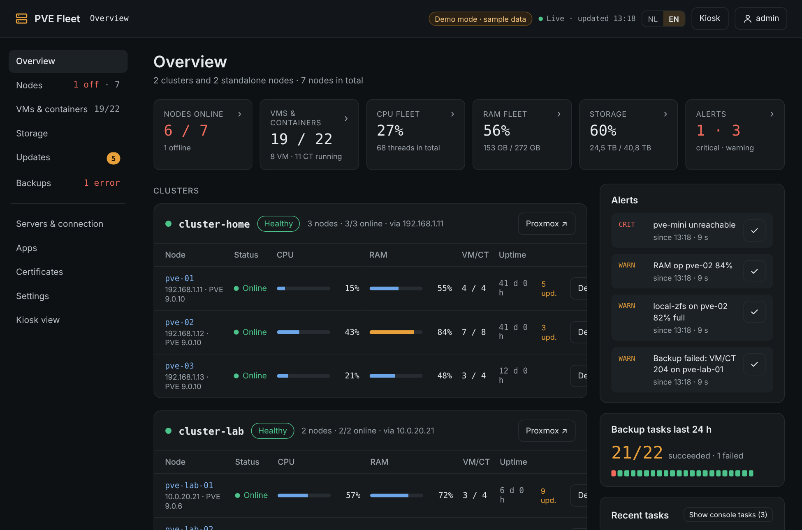
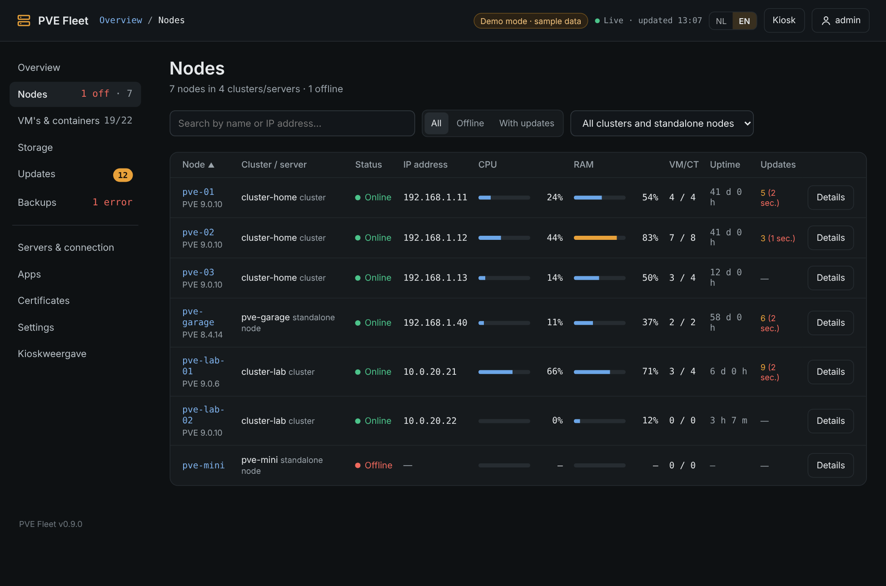
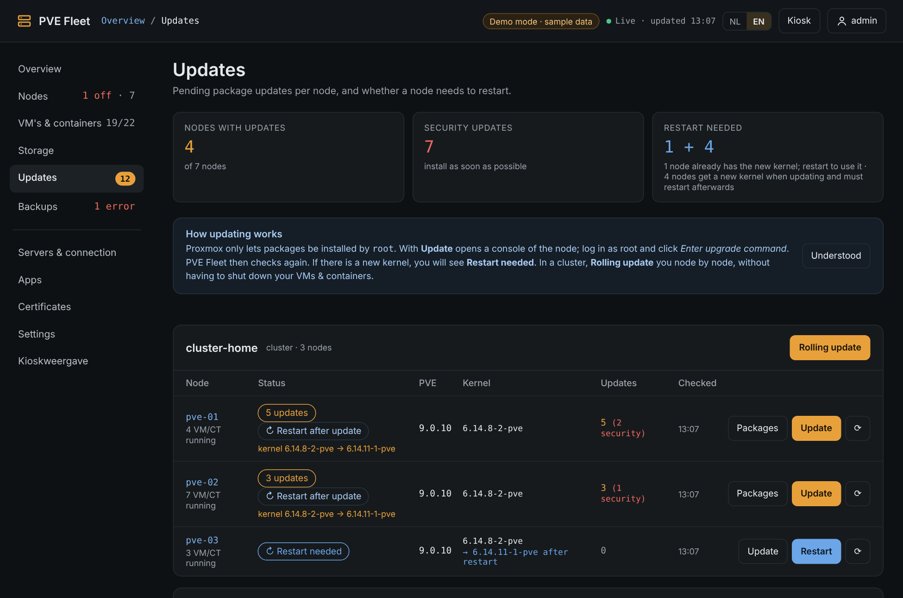
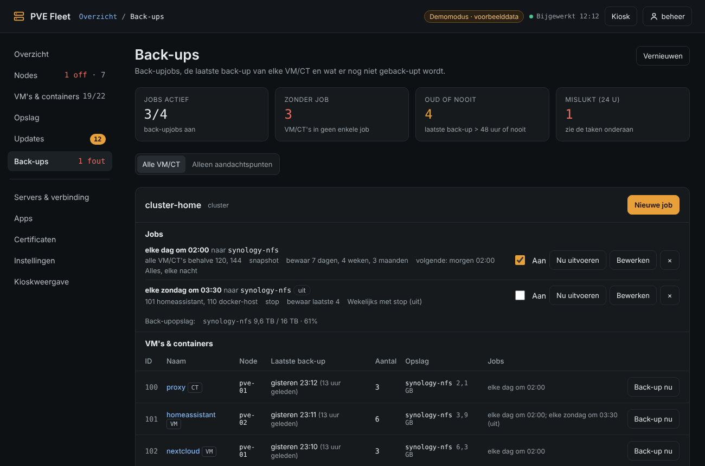
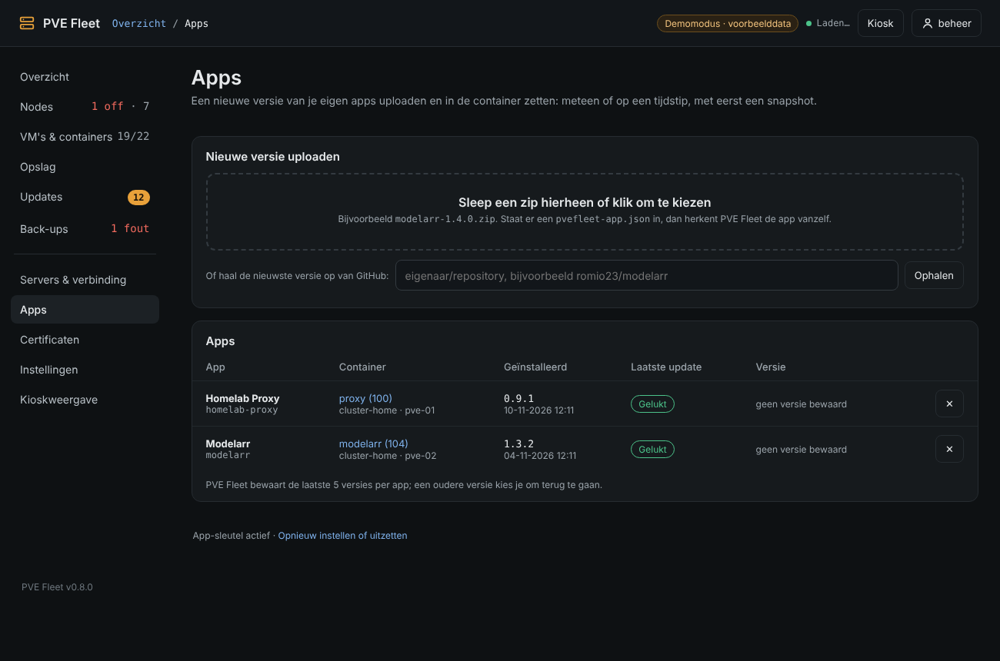

# PVE Fleet

🇳🇱 [Nederlandse handleiding](README-NL.md)

A dashboard for all your Proxmox VE servers on one screen: clusters *and* standalone nodes. You see the health of nodes, VMs and containers, with a separate kiosk view for an iPad or a small screen on a Raspberry Pi. The interface is available in **English and Dutch** (switch with the NL | EN buttons; by default it follows your browser language).

**Version 0.9.8.** Fix: if an automatic rolling update stops before it really starts (for example because the node script is too old), the reason is now shown on the start page; the move and start dialogs got *Tick all* / *Untick all*. Version 0.9.7: New: **fully automatic rolling update**. One click on *Update everything automatically*, and PVE Fleet does all nodes one after another: move the chosen VMs & containers, `apt-get dist-upgrade` on the node (your own configuration files are kept), reboot if there is a new kernel and wait until the node is back, start again what stayed, move everything back, next node. A log per node and a *Stop* button; on any error PVE Fleet stops at that node and does not continue. It uses the app key, so paste the installation command from *Apps* (Set up) once more (node script version 3). In step-by-step mode, nodes with nothing to do are now skipped by themselves. Version 0.9.6: fix: *Update all containers* first checks whether the script on the node knows the `upgrade` command, before making any snapshot, and says clearly which installation command to paste (the one from *Apps*, not the one from the update check). *Test and enable* on the Apps page now reports an outdated node script. Version 0.9.5: new: update everything at once. *Update all containers* updates the packages in the chosen containers unattended, one by one, with a snapshot first. *Update all apps* opens the app updates one by one. In the console PVE Fleet enters the update command by itself as soon as the root prompt appears, also for containers and apps. In the rolling update you choose per VM or container whether it is moved; what stays, PVE Fleet starts again after the restart. Version 0.9.4: new: backups to network storage. *Recent backup tasks* shows why a backup failed (from the Proxmox log). When unprivileged containers cannot write their temporary folder to an NFS/SMB share (`.tmp: Cannot open: Permission denied`), PVE Fleet explains it and gives the command that sets `tmpdir: /var/tmp` on all nodes. The backup-job editor warns in advance when a job on network storage contains unprivileged containers. Version 0.9.3: new: the *Updates* tile in the kiosk counts containers as well as nodes (for example *5 nodes · 7 containers · 16 security*). Backup jobs: buttons and an explanation for the note variables (`{{guestname}}`, `{{vmid}}`, `{{node}}`, `{{cluster}}`) with a live example. When a permission is missing (for example `Datastore.Allocate` on a backup storage), the message names that permission and shows the `pveum` commands to copy. Version 0.9.2: new: on the *Updates* page you choose how often the containers are checked: every few hours, or every day at a fixed time (*Change* next to "checked"). VMs and containers on a node that is offline keep their name, IP address and memory (last known data from `data/guest_cache.json`, with *last seen*); the status now reads *Node offline* instead of *Unknown*. The Docker image now contains time-zone data, so `TZ=Europe/Amsterdam` is really used inside the container. Version 0.9.1: fix: the list of community-scripts apps (`app/data/community_apps.json`) was missing from GitHub, so app updates in containers were not detected after updating from GitHub. Version 0.9.0: new: the whole interface and documentation in English and Dutch. Version 0.8.0: fetch the latest version of an app **from GitHub** (Apps) and `update.sh` to update PVE Fleet itself. Earlier (0.7.0): **Apps**, upload a new version of your own apps and put it in the LXC container, right away or at a set time, with a snapshot first (chapter 14). Earlier: certificates for PVE Fleet (https) and the Proxmox nodes, via Let's Encrypt or your own certificate (chapter 13); pairing screens with a QR code; updates in containers (packages and app versions, chapter 12); root session for the console, VMs & containers in the kiosk, the *Updates* (with rolling update) and *Backups* pages, VM/CT and node actions, built-in console, IP addresses and formatted notes.

## Screenshots

Taken in demo mode (sample data, no real servers).

| | |
|---|---|
|  **Overview:** clusters, nodes, alerts and backups on one screen |  **Nodes:** all nodes of all servers, search and sort |
|  **Updates:** pending updates per node and rolling update |  **Backups:** latest tasks and failed backups |
|  **Apps:** upload a new version or fetch it from GitHub and put it in a container | |

## What's inside

| Page | Address | What you see |
|---|---|---|
| Overview | `/` | Key figures (clickable), clusters with quorum, standalone nodes, alerts, backup tasks, recent tasks |
| Nodes | `/nodes` | All nodes of all clusters and standalone servers; search, filter (offline, with updates) and sort by CPU, RAM, uptime |
| VMs & containers | `/vms` | All VMs and containers across your servers; search by name/ID/tag/node, filters (running/stopped, VM/CT, per cluster or node), sorting and bulk actions |
| Storage | `/storage` | All storage, the fullest first; shared storage once per cluster |
| Node | `/node/<server>/<node>` | CPU/RAM/network/IO of the last hour, VMs and containers, storage, SMART, pending updates, tasks |
| VM/CT | `/guest/<server>/<node>/<qemu\|lxc>/<id>` | Graphs, configuration, IP address, snapshots, backups, button for the built-in console |
| Kiosk | `/kiosk` | Switch between **Nodes** and **VMs & containers** (filter running/stopped, tap for details); big tiles per node, alerts with a "seen" button, clock; restart/shut down/wake a node with a PIN; suited for touchscreens |
| Updates | `/updates` | Pending updates per node (security separately), kernel and whether a restart is needed; package list, updating via the console, rolling update per cluster (step by step or fully automatic) |
| Backups | `/backups` | Backup jobs (on/off, run now, create, edit, delete), latest backup per VM/CT, VM/CTs without a job, recent backup tasks |
| Apps | `/apps` | Your own apps: upload a zip, choose a version, update in the container now or later, with a snapshot and automatic rollback; scheduled and earlier updates with log |
| Settings | `/settings` | PIN on/off and change, kiosk options, pair screens, password, action log |
| Servers | `/servers` | Connection status per server and explanation about API tokens |

**Actions per place**

| Where | Actions |
|---|---|
| Node page | Restart or shut down the node (type its name to confirm), Wake-on-LAN and reconnect when it is offline. Select VMs & containers and start, shut down, restart, snapshot, back up or migrate them in one go |
| VM/CT page | Start, shut down, restart, force stop, create, roll back or delete a snapshot, back up now, migrate (the page moves along) |
| Kiosk | Restart node, shut down, Wake-on-LAN, reconnect, acknowledge notifications |
| Console | Screen of a VM, terminal of a container, shell of a node; opens in its own window (administrator only) |

Every action asks for confirmation first. At the bottom right you see the progress of the Proxmox task, with a **Log** button for the output. Everything is recorded in the log under Settings.

Alerts appear for: a server or node that is unreachable or offline, a cluster without quorum, RAM above 80/90%, CPU above 90%, storage above 80/90% and failed backup tasks in the last 24 hours.

---

## 1. Quick try (demo mode)

Without `data/config.yml` the dashboard starts with sample data, so you can look at everything first:

```bash
docker compose up -d --build
```

Then open `http://<ip-of-the-pi>:8080`.

Without Docker it works too:

```bash
python3 -m venv .venv && . .venv/bin/activate
pip install -r requirements.txt
python run.py
```

### First time: account and PIN

On first start the dashboard asks for a **username, password and kiosk PIN**. They are stored (hashed) in `data/settings.json`. Forgot your password? Delete that file and start again; you then set everything up again and pair your screens again.

## 1b. Testing on Windows

You can also run the dashboard on your Windows PC, handy for testing before it goes to the Pi.

1. Install **Python 3.9 or newer** (once). In PowerShell type `winget install Python.Python.3.13`, or download it from python.org and tick *Add python.exe to PATH*.
2. Extract the zip to a normal folder, for example `C:\PVE-Fleet`.
3. Double-click **`START_WINDOWS.bat`**.
   - The first time it creates its own Python environment (folder `.venv`) and installs the packages. That takes a minute.
   - Then your browser opens `http://localhost:8080` by itself.
   - To stop: close the black window or press Ctrl+C.
4. To test your own servers: copy `config.example.yml` to `data\config.yml`, fill in your servers and tokens and start again.

**`START_DEMO_WINDOWS.bat`** always starts with sample data, even if a `data\config.yml` exists.

The first time, Windows Firewall asks whether the program may communicate. Choose **Private networks** if you also want to try the kiosk on your iPad (`http://<ip-of-your-pc>:8080/kiosk`). If you only want to use it on the PC itself, start `START_WINDOWS.bat --host 127.0.0.1` in the command prompt.

Other options: `--port 9000` (different port) and `--no-browser` (do not open the browser).

If you have Docker Desktop, `docker compose up -d --build` from chapter 1 also works on Windows.

## 2. Preparing a Raspberry Pi

A Pi 4 with 2 GB is enough for the dashboard. If you also run the screen on the Pi itself (Chromium), take 4 GB or more.

1. Put **Raspberry Pi OS (64-bit)** on an SSD or SD card with Raspberry Pi Imager. Choose *Lite* if an iPad is the screen, or the desktop version if a screen is attached to the Pi. In the Imager, enable SSH, your username and your wifi right away.
2. Give the Pi a fixed IP address, for example with a DHCP reservation in your router.
3. Install Docker:
   ```bash
   curl -fsSL https://get.docker.com | sh
   sudo usermod -aG docker $USER   # then log in again
   ```

> Tip: an SSD over USB 3 lasts much longer than an SD card.

## 3. Installing

Copy this folder to the Pi (e.g. to `~/pve-fleet`), then:

```bash
cd ~/pve-fleet
mkdir -p data
cp config.example.yml data/config.yml
nano data/config.yml          # fill in servers and tokens, see below
docker compose up -d --build
```

Check that everything is running: `docker compose logs -f` and `http://<ip-of-the-pi>:8080/servers`.

Updating to a new version, in the PVE Fleet folder on the Pi:

```bash
sh update.sh            # fetches the latest release (or tag) from GitHub and rebuilds the container
sh update.sh --check    # only look: what is installed and what is the latest version
sh update.sh v0.9.0     # a specific release, tag or branch (for example main)
sh update.sh new.zip    # a zip from your own disk
```

The script first makes a backup of `data/` (next to the folder, the last three are kept), leaves `data/`, `.env` and your `docker-compose.yml` alone (a new compose file is placed next to it as `docker-compose.yml.new`) and runs `docker compose up -d --build`. A different repository: `REPO=owner/name sh update.sh`; a private repository: `GITHUB_TOKEN=... sh update.sh`. If there is no `update.sh` in your folder yet (version 0.7.0 or older), copy the files of the new version over the old ones once and run `docker compose up -d --build`; after that `update.sh` works. There must be a **release or tag** on GitHub: a plain commit on `main` does not count.

## 4. Creating an API token in Proxmox

Do this **once per cluster** and **once per standalone node**.

Via the web interface:

1. *Datacenter › Permissions › Users › Add*: user `dashboard`, realm *Proxmox VE authentication server* (`dashboard@pve`).
2. *Datacenter › Permissions › Add › User Permission*: path `/`, user `dashboard@pve`, role **PVEAuditor**.
3. *Datacenter › Permissions › API Tokens › Add*: user `dashboard@pve`, token ID `fleet`, **Privilege Separation off**. Copy the secret; you only see it once.

Or in a node's shell (recommended, including the permissions for actions):

```bash
pveum user add dashboard@pve --comment "PVE Fleet"
pveum role add FleetOperator --privs "VM.PowerMgmt VM.Snapshot VM.Snapshot.Rollback VM.Backup VM.Migrate Datastore.AllocateSpace Sys.PowerMgmt VM.Console Sys.Console VM.GuestAgent.Audit"
pveum acl modify / --users dashboard@pve --roles PVEAuditor,FleetOperator
pveum user token add dashboard@pve fleet --privsep 0
```

Did you already create a token in step 1? Then only the `pveum role add` and `pveum acl modify` lines are needed; the token itself stays the same.

### Permissions for actions

| Action | Permission in Proxmox |
|---|---|
| View everything | `PVEAuditor` (role) |
| Start, shut down, restart, stop a VM/CT | `VM.PowerMgmt` |
| Create or delete a snapshot | `VM.Snapshot` |
| Roll back a snapshot | `VM.Snapshot.Rollback` |
| Back up now | `VM.Backup` + `Datastore.AllocateSpace` on the backup storage |
| Migrate | `VM.Migrate` (+ `Datastore.AllocateSpace` for local disks) |
| Restart, shut down a node, Wake-on-LAN via the cluster | `Sys.PowerMgmt` |
| Console of a VM or container | `VM.Console` |
| Shell of a node | `Sys.Console` |
| IP address of a VM (via the QEMU guest agent) | `VM.GuestAgent.Audit` (Proxmox 9) or `VM.Monitor` (Proxmox 8) |
| Run a backup job now | `VM.Backup` + `Datastore.AllocateSpace` (already in FleetOperator) |
| *Optional:* read the list of pending updates, create/modify/delete/toggle backup jobs | `Sys.Modify` on `/` (see chapter 11) |

If you only want to look, give only PVEAuditor: every action then neatly reports which permission is missing.

**Checking permissions:** under *Servers & connection › Edit › Test connection* the dashboard reads the token's permissions. Per component you see ✓ or ✗. If something is missing, ready-made `pveum` commands are shown that fit your token exactly, with a copy button.

**Privilege Separation:** if you create the token in the web interface, *Privilege Separation* is on by default. The token then needs its own permissions, besides those of the user:

```bash
pveum acl modify / --tokens 'dashboard@pve!fleet' --roles PVEAuditor,FleetOperator
```

The single quotes are needed because of the exclamation mark.

### Wake-on-LAN

- **Cluster node:** the dashboard asks another node in the cluster to wake it. Proxmox must know the MAC address for that: `pvenode config set -wakeonlan AA:BB:CC:DD:EE:FF` (on the node to be woken, while it is still on).
- **Standalone node:** the dashboard sends the wake packet itself. Put the MAC address in `config.yml` with `wol_mac:` (see the example). On the Pi this works thanks to `network_mode: host` in `docker-compose.yml`; on Windows it works directly.
- Also enable Wake-on-LAN in the BIOS/UEFI of the server.

### Adding a server in the dashboard (recommended)

Go to **Servers & connection › + Add server**, enter the IP addresses, the token ID and the token secret and click **Test connection**. The dashboard:
- detects by itself whether it is a cluster or a standalone node, and fills in the name;
- shows per IP address whether it is reachable;
- offers to adopt the IPs of all cluster nodes;
- explains what is wrong if it does not work.

With **Add** or **Save** the dashboard writes `data/config.yml` and uses the new settings right away; no restart is needed. The previous version is kept as `config.yml.bak`. Comments you put in the file yourself disappear when saving. If demo mode is still on, it turns off by itself when you add your first server.

### Or: edit config.yml yourself

In `data/config.yml`:

```yaml
servers:
  - name: cluster-home
    hosts: [192.168.1.11, 192.168.1.12, 192.168.1.13]   # failover within the cluster
    token_id: "dashboard@pve!fleet"
    token_secret: "the-secret-from-step-3"
    verify_ssl: false
  - name: pve-garage
    host: 192.168.1.40
    token_id: "dashboard@pve!fleet"
    token_secret: "..."
```

Then restart with `docker compose restart`.

A few remarks:
- **PVEAuditor** may read everything and change nothing; the **FleetOperator** role above adds exactly the permissions for the actions.
- Depending on your Proxmox version, reading the **list of updates** needs more permissions (`Sys.Modify`). Without that permission the dashboard shows "no permission" for updates; the rest works fine.
- Proxmox uses a self-signed certificate by default, hence `verify_ssl: false`. If you have a valid certificate, set it to `true`.
- Make `data/config.yml` readable only for yourself: `chmod 600 data/config.yml`.

## 5. Kiosk on an iPad

1. In the dashboard on your PC, create a pairing code via **Settings › Paired screens › Pair screen**. You see a **QR code** and a digit code.
   - **QR code:** scan it with the iPad's camera and tap the notification. Safari opens the kiosk and the screen is paired right away.
   - **Digit code:** open `http://<ip-of-the-pi>:8080/kiosk` in Safari and enter the 6 digits.

   Both are valid for 10 minutes and work once. The iPad stays paired afterwards; you unpair it in Settings as well. If you open the dashboard on the Pi itself via `localhost`, PVE Fleet puts the Pi's network address in the QR code.
2. Share button › **Add to Home Screen**. The dashboard then opens full screen.
3. Settings › Display & Brightness › Auto-Lock: **Never**.
4. Settings › Accessibility › turn on **Guided Access**. Open the app and triple-click the side button or home button to lock the iPad to this screen.

Works well from iPadOS 15 (iPad Air 2 / mini 4 and newer). Preferably do not leave the iPad on the charger at 100% for years; a smart plug that charges between roughly 20% and 80% spares the battery.

## 6. Kiosk on a screen attached to the Pi

Use Raspberry Pi OS **with desktop** and set via `sudo raspi-config` › *System Options* › *Boot / Auto Login* that the Pi logs in to the desktop automatically.

Have Chromium open the kiosk at startup. On recent versions of Raspberry Pi OS (desktop *labwc*):

```bash
mkdir -p ~/.config/labwc
echo 'chromium --kiosk --noerrdialogs --disable-infobars --incognito http://localhost:8080/kiosk &' >> ~/.config/labwc/autostart
```

A browser on the Pi itself (`localhost`) does not need to be paired, as long as **Kiosk on this computer without pairing** is on (Settings). If the program is called `chromium-browser` on your system, use that name. If your Pi uses another desktop (such as *wayfire*), the autostart file is somewhere else; search for "autostart" for your version of Raspberry Pi OS.

## 7. Kiosk PIN

- By default the kiosk asks for the PIN on **restart node** and **shut down node**. Under *Settings › Kiosk & screens* you can also choose Wake-on-LAN and acknowledging notifications, and how long the kiosk stays unlocked afterwards (0 s, 30 s, 2 or 5 min).
- After 5 wrong attempts the kiosk is blocked for 1 or 5 minutes, or until you release the block in Settings. You then also get a notification in the dashboard.
- If you turn the PIN off, anyone who touches the screen can restart the nodes. For a screen in a public place, **View only** is safer.
- In the dashboard itself you are logged in with your password; no PIN is needed there.

## 8. Security

- The dashboard can restart and power off your servers. Therefore **never** expose it to the internet. If you use it away from home, go through a VPN (e.g. WireGuard or Tailscale).
- Logging in: after 5 wrong attempts per IP address, a 1-minute pause. "Stay logged in" lasts 30 days; after a password change other sessions are logged out.
- The dashboard runs over plain http in your own network. If you want https, see chapter 13 (Let's Encrypt or your own certificate) or put a reverse proxy in front (e.g. Caddy or Nginx Proxy Manager).
- `data/settings.json` contains the secret key for sessions and the hashed passwords; `data/config.yml` the API tokens. Keep the `data` folder private (`chmod 700 data`).

## IP addresses

In *Nodes*, *VMs & containers* and on the node page there is an **IP address** column. You can sort and search on it. If there are more addresses you see `+1` and the rest are in the tooltip.

- **Nodes:** the address from the cluster (for a standalone node the address PVE Fleet connects with).
- **Containers:** the address the container really has now. If it is off, the fixed address from the configuration (if there is one).
- **VMs:** via the QEMU guest agent. For that, *Options › QEMU Guest Agent* must be on in Proxmox for the VM, `qemu-guest-agent` must be running in the VM, and the token needs `VM.GuestAgent.Audit` (Proxmox 8: `VM.Monitor`). Without the agent PVE Fleet shows the cloud-init address if there is one, otherwise a dash.
- PVE Fleet fetches the addresses in the background, every 2 minutes for running and every 15 minutes for stopped VMs & containers. Right after starting you will therefore see dashes for a moment.

**Proxmox 8:** in the `pveum role` command use `VM.Monitor` instead of `VM.GuestAgent.Audit`. *Test connection* automatically gives the right command for your version.

## 9. Built-in console

On a VM/CT page there is a **Console** button, on a node page a **Shell** button. The console opens in its own PVE Fleet window. You do not need to log in to Proxmox separately.

**How it works:** PVE Fleet uses the API token to request a console from Proxmox and passes it on to your browser. Your browser therefore only talks to PVE Fleet, never directly to Proxmox.

| What | You see | Buttons |
|---|---|---|
| VM | The VM's screen (noVNC), as in Proxmox | Ctrl-Alt-Del, Fit to window, Full screen |
| Container | The container's terminal (xterm.js) | Paste, larger/smaller text, Full screen |
| Node | The node's shell | same |

Good to know:
- **Only the administrator** can open the console, not the kiosk. Every opened console is recorded in the log.
- **Permissions:** the token needs `VM.Console` (VM/CT) and `Sys.Console` (node shell). They are in the FleetOperator role from chapter 4. If you already had that role, update it with `pveum role modify FleetOperator --privs "…"` (the command is ready under *Test connection*).
- **Login prompt:** in a container you see the container's own login prompt. The node shell asks for a Linux login, because the token is not root@pam, unless you use a **root session** (below).
- **Root session:** when you open the first node shell, PVE Fleet asks once for the password of `root@pam` (and a 2FA code if you use one). PVE Fleet uses it to request a ticket from Proxmox, just like the web interface, and forgets the password immediately; it is stored nowhere. After that all shells of that cluster open without a login prompt, and with **Update** the upgrade command is entered right away. The ticket is valid for 2 hours and is extended as long as you use the console. At the top of the console you see *root session* with an **End** button; logging out of PVE Fleet or restarting PVE Fleet ends all root sessions. After 5 wrong passwords there is a one-minute pause. If you do not want this, choose **Without root (Linux login)**. Note: as long as the session is running, anyone logged in to PVE Fleet as administrator can open a root shell.
- The VM must be running. A stopped VM/CT has no console.
- Pasting: in a terminal with Ctrl+Shift+V or the **Paste** button. Pasting does not work in a VM screen (just like in Proxmox itself).
- In demo mode there is a simulated shell for containers and nodes; the VM screen does not work there.
- On Windows, PVE Fleet runs with the Werkzeug server (instead of waitress), because it supports websockets. In Docker, gunicorn runs.

## 10. Updates and rolling update

**Updates** (`/updates`) shows per node how many package updates are pending (security separately), which kernel is running and whether a newer kernel has been installed. Then it says **Restart needed**.

PVE Fleet may only read the list of updates if the token has `Sys.Modify` (a Proxmox requirement; see chapter 11). Without that permission PVE Fleet compares the nodes in a cluster: if a node is behind the newest one (PVE version or kernel), it says **Behind**, with the versions.

**Updating** works via the built-in console, just like the *Upgrade* button in Proxmox: Proxmox only lets `root` install packages, and an API token is not root. This is how it goes:
1. Click **Update**. A console of the node opens.
2. Log in as `root` with the node's password (with a root session this has already happened).
3. As soon as the root prompt (`#`) appears, PVE Fleet types `apt update; apt dist-upgrade` by itself (with a `;`, so an error in one repository does not stop the update). If it does not, click **Enter upgrade command**.
4. Read what will change and confirm with `Y`.
5. Close the window. PVE Fleet then checks again right away.

VMs & containers keep running during the update. Only a new kernel requires a restart.

**Rolling update** (for a cluster; the button reads **Update all nodes** when there is work to do): PVE Fleet helps you node by node:
1. **Move:** you choose per VM or container what goes to another node (by default everything that is running). VMs move live, local disks are copied along; containers are restarted briefly. You choose one target node or *Distribute* (each time to the node with the most free RAM). What you untick stays on the node and is briefly off during the restart. Or you skip this step entirely.
2. **Update** via the console, as above.
3. **Restart**, only if there is a new kernel. The page waits until the node is back.
4. **Start again:** what stayed on the node and is still off after the restart (for example without *Start at boot*), PVE Fleet starts again with one click.
5. **Restore:** everything that was moved goes back. Or you leave them where they are.

PVE Fleet stores what was moved in `data/rolling.json`; you can therefore close the page in between. You can also do a step in Proxmox itself; the page notices that automatically.

**Automatically** (since 0.9.7): the button **Update everything automatically…** does the steps above for all nodes one after another, without clicks in between. In the start dialog you tick per VM or container whether it moves (ticked) or stays and is briefly off during the reboot (unticked). Updating happens over SSH with the **app key** (chapter 14): the script on the node has one extra fixed command, `nodeupgrade`, which runs `apt-get update` and `apt-get -y dist-upgrade` with `--force-confdef --force-confold` on the node itself. So the app key may update the node; it still cannot run arbitrary commands. After updating PVE Fleet, paste the installation command from *Apps* › Set up once more and press *Enable and test* (script version 3).

- Before each node PVE Fleet checks that every node is online and the cluster has quorum.
- Nodes with nothing to do are skipped. If the update status of a node is unknown, PVE Fleet updates it anyway.
- PVE Fleet stops at the first error and does not continue: a failed move, an apt error, a node that does not go down within 5 minutes or is not back within 15 minutes. What was moved is in the plan, so you can continue step by step (or with *Continue automatically…*, which also moves back what an earlier run left elsewhere).
- *Stop* finishes the current step (a migration or reboot is never broken off halfway) and then stops.
- The progress is kept in `data/autorolling.json`. If PVE Fleet itself restarts during a run, the run is marked as interrupted and does not resume by itself.
- PVE Fleet must not run as a VM or container on the cluster it updates (on a Raspberry Pi it is fine).

Note for a **2-node cluster**: as soon as one restarts, the cluster loses quorum (unless you have a QDevice). Running VMs keep running, but starting, stopping and moving only work again when the node is back.

With the ⟳ button PVE Fleet checks again right away. Proxmox refreshes the package list itself every day; if the token has `Sys.Modify`, PVE Fleet can also refresh that list immediately.

## 11. Backups

**Backups** (`/backups`) shows per cluster or server:
- **Jobs:** when (in plain language, with the next run), to which storage, which VM/CTs, mode and how long backups are kept. You can switch a job on and off, **Run now**, edit or delete it, and create a **New job**.
- **VMs & containers:** the latest backup, how many there are and in which job they are. Red: *in no job* or *never*. Orange: older than 48 hours. With *Attention points only* you see just those.
- **Recent backup tasks**, including failed tasks.

You write schedules as in Proxmox: `02:00` (every day), `sun 03:00`, `mon..fri 21:00`, `sat 04:00`. Below the field you immediately see the next three runs, as Proxmox calculates them.

**Permissions:** viewing and *Run now* work with the permissions from chapter 4. **Creating, modifying, toggling or deleting** jobs requires the `Sys.Modify` permission on the whole datacenter in Proxmox. That permission may also change other settings (for example the network), which is why it is optional. If you want it anyway:

```bash
pveum role add FleetJobs --privs "Sys.Modify"
pveum acl modify / --users dashboard@pve --roles FleetJobs
# only if Privilege Separation is on:
pveum acl modify / --tokens 'dashboard@pve!fleet' --roles FleetJobs
```

*Test connection* shows this component with ○ if it is missing, and gives the commands under *Optional*.

**Backups to other storage** (for example an NFS or SMB share on a NAS): first add that storage in Proxmox (*Datacenter › Storage › Add*, with *Content: VZDump backup file*). For a job to that storage Proxmox also asks for `Datastore.Allocate` on that storage. PVE Fleet then names it in the message, with the commands, for example:

```bash
pveum role add FleetBackupTarget --privs "Datastore.Allocate Datastore.AllocateSpace Datastore.Audit"
pveum acl modify /storage/Synology-backup --users dashboard@pve --roles FleetBackupTarget
pveum acl modify /storage/Synology-backup --tokens 'dashboard@pve!fleet' --roles FleetBackupTarget
```

**Unprivileged containers and network storage:** their backup to NFS/SMB often fails with `.tmp: Cannot open: Permission denied`, because Proxmox wants to create the temporary folder on the share. Let Proxmox create that folder locally; this changes all nodes (once, in the shell of a node):

```bash
for ip in $(grep -oP '"ip": "\K[^"]+' /etc/pve/.members); do
  ssh -o ConnectTimeout=5 root@$ip 'grep -q "^tmpdir:" /etc/vzdump.conf || echo "tmpdir: /var/tmp" >> /etc/vzdump.conf; echo "$(hostname): $(grep ^tmpdir: /etc/vzdump.conf)"'
done
```

PVE Fleet cannot set this per job: in Proxmox only `root@pam` may set the `tmpdir` option. A new node in the cluster does not have the line yet; run the command again then.

**Note for each backup:** plain text with the variables `{{guestname}}`, `{{vmid}}`, `{{node}}` and `{{cluster}}`. Below the field there are buttons to insert them, and an example.

Backups on a Proxmox Backup Server (PBS) are shown too, via the PBS storage in Proxmox. Fetching can then take a moment; PVE Fleet remembers it for 5 minutes (the **Refresh** button fetches it right away).

## 12. Updates in VMs & containers

PVE Fleet shows per container how many **package updates** are pending (Debian/Ubuntu with apt, Alpine with apk, Fedora/Rocky with dnf) and whether there is a **new version of the app**. You see it on the *Updates* page (at the bottom), in the **Updates** column under *VMs & containers* (with the *With updates* filter), on the container's page and in the kiosk. The number next to *Updates* in the menu includes the containers.

**How it works:** Proxmox does not know what is installed inside a container. PVE Fleet therefore looks via **SSH** on each node, with its own key that may only start one check script (`command="bash /etc/pve/pvefleet/check.sh",restrict` in `authorized_keys`). That script runs a simulation in every running container (`apt-get -s dist-upgrade`, `apk version`, `dnf check-update`) and installs nothing. If the package list in the container is older than 6 hours, it refreshes it first (`apt-get update`). By default every 6 hours. Click **Change** next to "checked" on the *Updates* page to choose every 1, 2, 3, 6, 12 or 24 hours, or every day at a fixed time (for example 05:00, local time). If PVE Fleet was off at that time, it checks as soon as it runs again. Without a choice on the page, `guest_updates_hours:` in `config.yml` still applies.

**One-time setup** (per cluster or standalone node): *Updates* › *Updates in VMs & containers* › **Set up**. Copy the command and paste it into the shell of one node. It places the script in `/etc/pve/pvefleet/` (shared in the cluster) and adds the key. Then click **Enable and test**. If a node refuses the key, paste the command on that node as well. The key is in `data/ssh/` on the Pi; keep that folder private. To turn it off: the **Turn off** button and the removal command shown with it.

**App versions:** containers from the [community-scripts](https://community-scripts.org) store the installed version in `/root/.<app>`, and their update scripts name the GitHub repository. PVE Fleet recognises more than 400 apps this way and compares with the latest release on GitHub (remembered for 12 hours). If PVE Fleet does not recognise an app, or you want a different repository, set it on the container's page (*Set up app repository*). Without a token GitHub allows 60 requests per hour; if you have many containers, put `github_token: "<token>"` in `config.yml` (a token without permissions is enough).

**Updating:** **Update** (packages) and **Update app** open the container's console. As soon as the root prompt (`#`) appears, PVE Fleet types the command by itself: `apt update; apt dist-upgrade` (or `apk`/`dnf`) or `update` (the community-scripts update script). If you first see `login:`, log in as root; the command follows. By default PVE Fleet first creates a **snapshot** (`before-update-…`), so you can go back. Delete it later via the container's page.

**Update all containers:** updates the packages in all chosen containers without a console, one by one: snapshot (`pvefleet-…`, the last 2 per container are kept), then `apt-get dist-upgrade` with `--force-confold` (your own configuration files are kept), or `apk upgrade` / `dnf upgrade`. You see a log per container and a summary (done, failed, restart needed); afterwards PVE Fleet checks again. For this PVE Fleet uses the **app key** from chapter 14 (which may already put files into containers), not the key that may only look. If you set up the app key before 0.9.5, paste the installation command (*Apps* › *Set up*) once more: the script on the node then knows the `upgrade` command.

**Update all apps:** the community-scripts update scripts sometimes ask questions, so they do not run unattended. PVE Fleet opens them one by one, each in its own console with `update` already entered; when you close a console, the next app follows.

Not yet: VMs (that can follow later via the QEMU guest agent) and Docker containers inside a VM or container.

## 13. Certificates (https)

Under **Certificates** in the menu you arrange https for PVE Fleet itself *and* for the web interface of your Proxmox nodes (port 8006).

**1. DNS provider (for Let's Encrypt).** Let's Encrypt verifies with a temporary DNS record that the domain is yours (DNS-01). PVE Fleet creates that record through your DNS provider's API and cleans it up afterwards. Nothing needs to be opened to the internet.
- **TransIP:** control panel › *Account* › *API*: enable the API and create a *Key Pair*. Leave *Whitelisted IP addresses only* off (or enter the IP address of your internet connection). Enter your TransIP username and paste the whole private key.
- **Cloudflare:** *My Profile* › *API Tokens* › *Create Token* › template **Edit zone DNS**, with your domain under *Zone Resources*. Paste the token.
- Enter an email address (Let's Encrypt emails if a certificate is about to expire and has not been renewed) and click **Test connection**: you then see your domains.
- If you want to practise first, turn on *Use the Let's Encrypt staging environment*. Those certificates are not valid, but there are no limits. Turn it off again afterwards and request again.

**2. https for PVE Fleet.** Click **Requests to Let's Encrypt** and enter the name, for example `fleet.example.com`. Or click **Load own certificate** for a certificate from another provider (certificate, optionally an intermediate certificate, and an unencrypted key, as PEM text or file). PVE Fleet then starts https on port **8443** (configurable), next to http on 8080. With *Redirect http to https* everyone automatically goes to `https://<name>:8443`.
- Point the name at the Pi in your own network: a DNS entry in your MikroTik, Pi-hole or AdGuard, for example `fleet.example.com` → `192.168.2.20`.
- An iPad that was paired via the IP address must be paired again via the name (cookies belong to the name). So only turn on the redirect once you open the kiosk via the name. A browser on the Pi itself (`http://localhost:8080/kiosk`) is not redirected, so the kiosk on the Pi keeps working without pairing.
- In Docker, PVE Fleet runs in a single process for http and https (`python run.py`); thanks to `network_mode: host` port 8443 is reachable right away.

**3. Proxmox nodes.** Enter the base domain (for example `example.com`); PVE Fleet suggests `<node>.example.com` per node, and you can adjust that per node. Click **Request** (or **Request for all online nodes**): PVE Fleet requests the certificate and installs it on the node (`/nodes/<node>/certificates/custom`). That node's web interface restarts for a few seconds; VMs and containers notice nothing. With **Load** you install your own certificate on a node.
- For that the token needs the `Sys.Modify` permission (*Servers & connection* › *Test connection* › *Optional*), or an active root session (first open a shell as root).
- After that you can use the names instead of the IP addresses under *Servers & connection* and turn on *Verify certificate*.

**Renewal:** Let's Encrypt certificates are valid for 90 days. PVE Fleet renews them automatically 30 days before they expire (checked twice a day), for PVE Fleet and for every node with *auto* ticked. You renew your own certificates yourself.

**Storage:** everything is in `data/tls/` (readable only by PVE Fleet): your DNS provider's API key, the Let's Encrypt account and the certificates. Include that folder in your backup.

## 14. Updating apps (your own apps in an LXC)

Under **Apps** you put a new version of your own apps (for example Modelarr, the Homelab Proxy or a PHP website) in the container: upload a zip, choose the container, **Now** or **At a set time**. PVE Fleet first creates a snapshot, places the files without overwriting your data, restarts the app and checks whether it responds again. If that fails, the container automatically goes back to the snapshot.

**One-time setup.** *Apps* › **Set up**: copy the command and paste it into the shell of one node of the cluster (standalone nodes: on every node). It places `deploy.sh` in `/etc/pve/pvefleet/` and adds a second PVE Fleet SSH key, restricted to that script:

```
command="bash /etc/pve/pvefleet/deploy.sh",restrict ssh-ed25519 … pve-fleet-deploy
```

Then click **Enable and test**. The key can only: receive a package, put it with `pct push` in a running container in a folder under `/opt`, `/srv`, `/var/www` or `/home`, and restart the app there; also update the packages in a running container (*Update all containers*, `apt-get dist-upgrade` inside the container) and update the node itself (`apt-get dist-upgrade`, for the automatic rolling update). No shell on the node. Note: updating an app means the code of that app (and any post-install script) runs as root in the container; only a PVE Fleet administrator can start that.

**The description: `pvefleet-app.json`.** Put this file in the zip (in the root or in the single top folder). Without this file PVE Fleet asks for the details at the first upload and remembers them for the next version.

```json
{
  "name": "modelarr",
  "title": "Modelarr",
  "version": "1.4.0",
  "type": "systemd",
  "dir": "/opt/modelarr",
  "keep": ["data/", "config.yml", ".env"],
  "service": "modelarr",
  "venv": "venv",
  "post_install": "scripts/after-update.sh",
  "health": { "port": 8085, "path": "/healthz" }
}
```

| Field | Meaning |
|---|---|
| `name`, `title`, `version` | Technical name (lowercase), display name, version |
| `type` | `systemd` (service, for example Python/Flask), `compose` (`docker compose up -d --build` in the folder) or `static` (website files, PHP/HTML) |
| `dir` | Folder in the container, under `/opt`, `/srv`, `/var/www` or `/home` |
| `keep` | Paths that are never overwritten if they already exist (data, settings). If they do not exist yet, they come from the zip |
| `service` | systemd: the service that is restarted (required). static: optionally reload, for example `apache2` |
| `venv`, `requirements` | Optional: Python environment in the app folder; packages from `requirements.txt` are updated (the environment is created if it does not exist yet) |
| `owner` | Optional: owner of the new files, for example `www-data:www-data` |
| `post_install` | Optional: script in the app that runs after placing the files and before restarting (for example database migrations) |
| `github` | Optional: `owner/repository` (for example `romio23/modelarr`); PVE Fleet can fetch the latest version from there, see below |
| `health` | Optional: `port`, `path` (and `scheme`, `timeout`): PVE Fleet requests `http://<container-ip>:<port><path>`; a response below 500 counts as "working" |

PVE Fleet drops the top folder of the zip, skips `__pycache__/` and `.git/`, and puts `pvefleet-app.json` in the app folder. This way PVE Fleet can later see which version is installed.

**Updating.** After uploading you choose the container (PVE Fleet suggests the previous one or a container with the same name) and see what is on it now: newer, same or older. Options: snapshot beforehand (on by default; PVE Fleet keeps the last 2 per container, with names starting with `pvefleet-`) and automatic rollback. You can cancel a scheduled update or start it right away. One update runs at a time.

**Fetching the latest version from GitHub.** If the app is on GitHub, you do not need to download and upload the zip yourself. Under *Apps*, below the upload box, enter `owner/repository` (for example `romio23/modelarr`) and click **Fetch**. PVE Fleet fetches the latest **release**, or if there is none the latest **tag** (a plain commit on `main` therefore does not count: create a release or tag on GitHub, for example `v1.4.1`). After that it goes as with an upload: check the description, **Save**, **Update…**. If the GitHub address is in `pvefleet-app.json`, PVE Fleet remembers it: the list then has a button *Fetch GitHub v1.4.1* (prominent if that is newer than what you have) and it checks every 10 minutes what the latest version is. A private repository works with a token (`github_token` under Settings). Fetching does not put anything in a container by itself.

**Going back to a previous version.** PVE Fleet keeps the last 5 versions per app. Choose one in the *Version* column and click **Update…**. Or restore a snapshot on the container's page.

**First time.** The app must already have been installed once (with its own install script), so that for example the systemd service exists. After that the updates go through PVE Fleet.

**Storage:** `data/apps/` (stored versions and the history) and `data/ssh/deploy_ed25519` (the app key).

**Turning off:** *Apps* › *Reset or turn off* › **Turn off**, and paste the removal command on a node.

## Troubleshooting

| Message | Cause |
|---|---|
| `none of the hosts reachable` | Wrong IP address, port 8006 closed, or the node is off |
| `401/403: no permission` | Token ID or secret incorrect, or the token has no PVEAuditor (mind Privilege Separation) |
| Updates: "no permission" / "? Not visible" | Proxmox only lets the list of updates be read with `Sys.Modify`. Without that permission PVE Fleet shows whether a node is **behind** the newest node in the cluster. If you want the full list: see chapter 11 (optional permission) |
| Windows: `Microsoft Visual C++ 14.0 or greater is required` | Fixed since 0.1.2: the start file now builds PyYAML without a compiler. Just start `START_WINDOWS.bat` again |
| Action: "the API token lacks permissions" | Give the token the FleetOperator role (chapter 4, *Permissions for actions*) |
| Wake-on-LAN: "No MAC address known" | Put `wol_mac` in `config.yml` (standalone node) or set the MAC address in Proxmox (cluster node) |
| Container does not start: `PermissionError ... /data/settings.json` | The `data` folder does not belong to user 1000. Fix with `sudo chown -R 1000:1000 data` |
| Kiosk keeps showing the pairing screen | The pairing code is valid for 10 minutes and works once; create a new one |
| Console: "the API token lacks the VM.Console permission" (or Sys.Console) | Update the FleetOperator role, see chapter 9 |
| Console: "The connection was unexpectedly lost" | The console session expired (60 seconds to connect) or Proxmox closed it. Click **Reconnect** |
| Backup job: "the API token may not create or modify backup jobs" | The token lacks `Sys.Modify`; see chapter 11 (optional) |
| Updating: the console asks to log in | Normal: log in as `root` with the node's password |
| Updating: `Temporary failure resolving 'deb.debian.org'` | The node cannot look up DNS names. Set a DNS server under *node › System › DNS* in Proxmox and try again |
| Console dropped during an upgrade | Fixed in 0.3.1. Did it happen anyway? Log in again and run `dpkg --configure -a`, then `apt dist-upgrade` again |
| Updating: `401 Unauthorized` from `enterprise.proxmox.com` | The enterprise repository is on without a subscription. Turn it off: *node › Updates › Repositories*, select the line with `enterprise.proxmox.com` and click **Disable** (also for Ceph enterprise if present). The *no-subscription* repository must be on |
| Updates in containers: "refuses the PVE Fleet key" | Paste the install command (Updates › Set up) in that node's shell as well |
| Updates in containers: "SSH host key has changed" | The node was reinstalled (or the IP address now belongs to another device). Delete the line for that address from `data/ssh/known_hosts` |
| App version with `?` | GitHub was not reachable or the limit of 60 requests per hour was reached. Put `github_token` in `config.yml` or wait an hour |
| Certificate: "TransIP login failed" | Username or key is incorrect, or the key only accepts whitelisted IP addresses. Create a key without whitelist or enter your IP address |
| Certificate: "DNS record was not visible" | The DNS provider was slow. Try again in a few minutes. If you also use your own nameservers next to the provider, check where the domain really points |
| Certificate: "Let's Encrypt limit reached" | Requested too often for the same name (5 per week). Wait, or practise with the staging environment |
| https: "Port 8443 is not available" | Another program is using the port. Choose a different https port under Certificates |
| Browser warns on https via the IP address | The certificate belongs to the name. Open PVE Fleet via the name (and point it at the Pi in your network) |
| Apps: "refuses the PVE Fleet app key" | Paste the install command (*Apps* › *Set up*) in the shell of a node of that cluster (standalone nodes: on that node) |
| Apps: "folder not allowed" | The folder in the description must be under `/opt`, `/srv`, `/var/www` or `/home` |
| Apps: "The service … is not running after the restart" | The new version does not start. PVE Fleet restores the snapshot; check the log for the error the service gave (`systemctl status` is included) |
| Apps: "the app does not respond after the update" | The check (`health`) got no response in time. Is the port right? If the app starts slowly, increase `timeout` in the description |
| Apps: snapshot failed | The container's storage does not support snapshots (for example directory-type storage). Turn off *Take a snapshot first*; then there is no automatic rollback |
| Empty graphs | Proxmox has no RRD data yet for this node or VM/CT (e.g. just started) |

More details in the logs: set `LOG_LEVEL=DEBUG` in `docker-compose.yml`.

## Languages

The interface and this documentation are available in English and Dutch. The switch (NL | EN) is at the top of every page; without a choice PVE Fleet follows the browser language. The Dutch texts are the source; the English translation lives in `i18n/en.tsv` and is turned into `app/static/js/i18n-en.js` with `python3 tools/build_i18n.py`. Something missing or wrong in the English text? Add or fix a line in `i18n/en.tsv` (Dutch `|||` English) and open a pull request.

---

Made with Claude (claude.ai).

## License

MIT — see [LICENSE](LICENSE).
